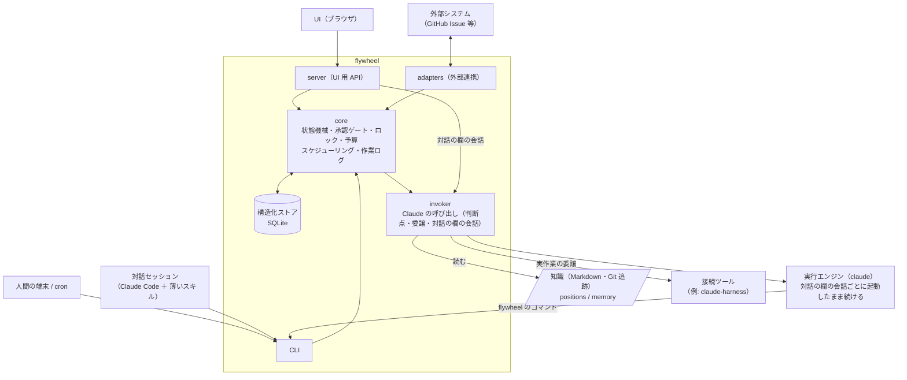
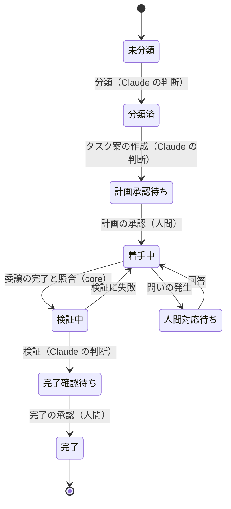

# flywheel アーキテクチャ設計

- 状態: **確定**（2026-09-20 に `main` へマージ＝flywheel#1）。2026-09-21 の決定（D12〜D16）と、2026-10-09 の決定（D17・D18。M4 の機能仕様の起案に対するオーナーの決定）、2026-10-10 の決定（D19〜D21）、2026-10-12 の決定（D5・D18・D19 の改訂。M4 の UX モックを触ったオーナーの判断＝flywheel#207）、2026-10-22 の決定（Q6・Q12。[M4.5 の機能仕様](features/m4.5-learning-and-self-improvement.md) の M45H1〜M45H14）を反映済み。2026-11-17 の設計の見直し（D22〜D34）は §21 にまとめた。§21 の形は未実装（区切り S1「外す」〔D28 のうち同時に進めてよいかの判断点（J9）とコンフリクトの予測を外す部分、D29 のうち課題どうしをコンフリクトの見込みで直列にしない部分、D33 のうちオーナーの回答待ちの実行を数えない部分〕は実装済み。参照: features/core-redesign.md）で、§1〜§20 の見直し前の記述は書き換えずに残してある（見直しで足したのは、§2 の D22〜D34・§8.3 のファイル名の決まり・§17 の「設計の見直しの後の進め方」・§19 の「設計の見直しのリスクと撤退条件」・各所の印と追記。見直しで足した記述では、用語集に合わせて「本番反映」を「反映」、「本番」を「反映先」と書く。見直し前の記述には「本番反映」「本番」が残る）。この文書の中で §21 と食い違うところは、§21 を正とする。主な箇所には「2026-11-17 の設計の見直しで改める」の印を付けた（§2 の D11・D20・D21、§3 の P4、§5、§6、§7、§8.2、§9、§10、§11、§12、§13、§14、§16 の Q11）
- 用語集: [docs/glossary.md](glossary.md)（人が読む文章で使う語。この文書の「周」「接続ツール」などの古い言い方は、機能仕様の書き換えのときにそろえる）
- 起草: 2026-09-20
- M1 の機能仕様: [docs/features/m1-core.md](features/m1-core.md)
- M4.5 の機能仕様: [docs/features/m4.5-learning-and-self-improvement.md](features/m4.5-learning-and-self-improvement.md)
- M5 の機能仕様: [docs/features/m5-tom-migration-and-switchover.md](features/m5-tom-migration-and-switchover.md)
- 経緯: [claude-flywheel#99](https://github.com/masanami/claude-flywheel/issues/99)（方針変更と前提決定の記録）

> **この文書の読み方** — 各項目には確度を付けている。
> **【決定】** 人間が決めた事項（日付つき）。**【仮定】** 起草者が推奨として置いたもの。異論が無ければそのまま進む。**【未決】** 人間の判断が要るもの（§16 にまとめてある）。

---

## 1. 背景: 何を解くのか

flywheel は、自律エージェントが課題を取り込み、計画し、実作業を委譲し、検証し、学習するサイクルを回す仕組みである。現在は Claude Code プラグイン（`claude-flywheel`）と、読み取り中心の UI（`claude-flywheel-board`）の 2 つで構成されている。

### 1.1 解きたい課題【決定 2026-09-20】

1. **Claude を必要としない処理まで Claude が実行しており、無駄にコストがかかる。** スクリプト化で改善はされたが、スクリプトを呼ぶのは依然として LLM セッションである。
2. **UI をシステムに含めたい。ただし Markdown をデータソースにすると UX に限界がある。**
3. **現状の管理はユーザーの認知力を要求する。** UI/UX による支援が今後重要になる。
4. したがって**データの持ち方を含めて**作り直す。**UI からの状態変更**と**外部システムとの連携**も射程に入れる。

### 1.2 実測による裏付け

**散文は個別の是正では減らない。** `run-cycle/SKILL.md` は 73,598 B（2026-08-20）から **130,145 B**（2026-09-14）へ 77% 増えた。この間に「分量と散文で持つべき規定の範囲を見直す」課題（claude-flywheel#97）が完了しているにもかかわらず、である。

**散文の大半は、判断ではなく制御である。** 現行 `run-cycle` の手順別の分量と中身（2026-09-14 時点）:

| 手順 | 分量 | 中身の実態 |
|---|---:|---|
| 0. 観測・取り込み | 15.1 KB | ロック取得・heartbeat・外部ソースの取り込み・fingerprint 照合。**ほぼ全部が決定的** |
| 1. 整理 | 9.2 KB | 課題が自ポジションのものかの分類。**判断** |
| 2. 計画 | 18.3 KB | タスク案の作成は**判断**。予算・枠・直列化グループの算出は**決定的** |
| 3. 実行 | 51.9 KB | 依存ゲート・スロット割り当て・費用ガードの評価式・枠超過の伝播・起動と合流・イベント記録・結果の照合。**大半が決定的**。判断は「ブリーフを書く」「子の問いに答える」の 2 つ |
| 4. 検証 | 4.3 KB | 成果が完了条件を満たすかの**判断** |
| 5. 学習 | 0.8 KB | 知見の記録。**判断** |
| 6. 報告・コミット | 26.6 KB | バリデータ・pathspec コミット・未終了イベントの検算・ロック解放。**ほぼ全部が決定的** |

**コンテキストの固定費が構造的に大きい。** 1 サイクルごとに約 66k トークンの固定文脈を読み、さらに 1 セッションで複数周回すと親のトークンが二乗的に積み上がる（実測: 親 1,793 ターンでキャッシュ読み 8 億トークン）。現在は「1 サイクル = 1 セッション」という運用規律で抑えている。

**Markdown 正本は UI 側にもコストを払わせている。** board は 38,706 行のうち **7,229 行が Markdown のパース層**である。書き込みは「承認チェックボックス 1 行の置換」だけが許可された唯一の経路で、優先度の並べ替え・新規起票・人間記入欄の編集は実装できないまま止まっている。

**運用者は実際に迷っている。** 1 か月の運用で繰り返し迷った点として、次の 5 つが報告されている（claude-flywheel#111）。本設計が UI/UX で解消すべき認知負荷の実例として扱う（対応は §12.3）。

1. サイクルを回すのか、対話で指示するのか
2. 承認はいつ・どこで行うのか
3. 「サイクルの終わり」と「仕事の終わり」がずれる
4. 1 セッションで何周回してよいのか
5. 定期実行と都度実行のどちらが標準か

---

## 2. 決定済み事項

| # | 決定 | 日付 |
|---|---|---|
| D1 | 「当面プラグイン継続・実装しない」を撤回し、**システム化へ移行する** | 2026-09-20 |
| D2 | **新設リポジトリ（本 repo）で作り直す。** 旧 2 repo（claude-flywheel / claude-flywheel-board）は切り替えまで**保守モード**（日々の運用に必要な修正のみ） | 2026-09-20 |
| D3 | **状態の正本は構造化ストア**にする。board 側の既存決定「正本はファイルベース維持・DB 化は不採用」を覆す | 2026-09-20 |
| D4 | **Git による監査性は重視しない。作業ログが分かれば足りる** → イベントソーシングは採らない | 2026-09-20 |
| D5 | **GitHub 上でのチェックボックス承認は廃止。承認は、人間が直接行う操作（UI のボタンと、端末での対話的な確認を伴う CLI）と、人間が対話で伝えた承認を LLM が記録する操作に限る。** 当初は「AI への指示による承認（対話で『承認して』）を維持」としたが、自己承認を防ぐ仕組みが複雑かつ不完全になるため、同日のレビューで外した。2026-10-12 に対話での承認を戻した: 新しい構成では 1 周を core が進め、`flywheel` を実行できる LLM はオーナーが対話しているセッションだけになる（判断点は Bash を持たず、委譲の子は `flywheel` を禁じられる）。記録には「LLM が対話で受けた」ことと会話の手がかりを必ず残す。予算の増額も同じ口で受ける（§9・[M4 の機能仕様](features/m4-ui-server.md) M4H21・M4H28） | 2026-09-20（同日改訂）・2026-10-12 改訂 |
| D6 | 既存データの移行は**システムの形が固まってから検討**する。方向は一括移行。2026-10-18 に、全ワークスペースを一括では移さず、Tom を先に移して問題が出たら直しながら進め（対策前進）、その後に他のワークスペースを移すと改めた。2026-10-25 に、旧台帳の変換スクリプトを作らず、open の課題とその状態だけを移すと改めた。2026-10-29 に、移行は機能として開発せず手順と使い捨ての簡易スクリプトで行い、切り替えの後も常設で要るもの（書き出しとそのコミット）だけを機能にすると決めた（§18・[M5 の機能仕様](features/m5-tom-migration-and-switchover.md) M5H5・M5H7） | 2026-09-20・2026-10-18・2026-10-25・2026-10-29 改訂 |
| D7 | **flywheel は開発特化の自律エージェントで、開発のフロー（YAML の定義と、それを進める仕組み）を自分で持つ。フローのステップの中の指示文（スキル・エージェント）は、claude-harness のプラグインを使う。** 当初は「ドメイン非依存の自律エージェントであり、開発特化の接続ツール（claude-harness 等）を取り込まない。接続ツールはエージェントの立ち上げ時に指定する」だった。2026-11-23 に開発特化と割り切り、2026-11-24 に、claude-harness の実行の仕組みを flywheel へ移植すると決めた（D35。flywheel#981）。宣言で外の委譲先を指定する口（スキルを呼ぶ形・外部コマンドの形・指示文だけの形）は、組み込みのフローが Tom で安定するまで残し、外すかは別に決める。ビジネスドメイン（業界・製品の分野）に依存しないことは変わらない | 2026-09-20・2026-11-24 改訂 |
| D8 | claude-harness の配布形態（プラグインか CLI か）は **harness 側が単独で決める**。flywheel の決定を待たない（claude-harness#201） | 2026-09-20 |
| D9 | **ストアはエージェントごとに持つ**（ワークスペース内に 1 ファイル）。エージェント横断の表示は UI が複数のストアを束ねて行う | 2026-09-20 |
| D10 | **ストアは Git で追跡しない。復旧のために、JSON の書き出しを定期的にコミットする**（監査のためではない＝D4） | 2026-09-20 |
| D11 | **個別操作を基本にし、サイクルは「進められるものを全部進める」一括操作として残す** **2026-11-17 に D26 で、サイクルを「走っているタスクを見ながら進める」形へ改めた（個別操作は残し、新しい個別操作は足さない。§21.4）** | 2026-09-20・2026-11-17 改訂 |
| D12 | **完了の承認と本番反映の承認は、人の 1 回の操作で両方を承認し、作業ログには別々の記録として残す。** モデル上のゲートは 3 つ（計画・完了・本番反映）のまま持つ。「完了だけ承認して、本番反映は保留」も選べる（§9） | 2026-09-21 |
| D13 | **配布は当面、オーナー自身の環境だけ**（Q7 を決定）。公開パッケージ化・他者への配布は M5 の後に判断する。ただし**環境固有のパスをコードへ埋めない**ことは最初から守る | 2026-09-21 |
| D14 | **バックエンド（core・CLI・server・invoker・adapters）は Go、フロントエンド（UI）は React / TypeScript。** SQLite は C コンパイラ不要の実装を使い、バイナリ 1 つで配れる形にする。§4 の構成は変わらない（変わるのは §15 だけ）。claude-harness の runtime（claude-harness#201）と言語はそろうが、**コードは共有しない**（D7・D8） | 2026-09-21 |
| D15 | **モバイルからも UI へアクセスできるようにする（要件の追加）。** UI の主たる形はブラウザ UI になる。端末の外から届く経路と、その経路での本人確認・承認をどこまで開くかは **M4 の設計課題**とした（§12.4・Q9）。2026-10-09 に [M4 の機能仕様](features/m4-ui-server.md) で決めた（本人確認は D18） | 2026-09-21 |
| D16 | **UI はブラウザ UI で始める。** デスクトップアプリ化・モバイルアプリ化は、ブラウザでは対応できないことが実際に出てきた時点で検討する。そのため UI は「API を呼ぶ React」として作る | 2026-09-21 |
| D17 | **定期実行は要件にしない**（Q5 を決定）。flywheel はスケジューラも cron の設定の生成も持たない。1 周（一括の操作）は CLI か、UI の手動の起動の口から始める（[M4 の機能仕様](features/m4-ui-server.md) M4H11） | 2026-10-09 |
| D18 | **UI で受ける承認は計画と完了だけにし、ボタンを押すだけで成立させる。UI の完了の承認は常に本番反映を保留扱いにし、本番に届く承認（既定ブランチへの昇格・`release`・`delete`・`external_send`）は端末か対話に限る。** 範囲は core が強制し、記録は `channel=ui`・`verification=none` で残す。UI の差し戻し・回答・予算の増額は持たない（差し戻しと回答は対話で伝える）。2026-10-09 の版は「UI からの承認・差し戻し・回答・予算の増額は、操作のたびにパスキー（WebAuthn の利用者確認つきの署名）で本人確認する」としたが、普通の開発の承認で毎回生体確認を求めるのは過剰だとして改めた。ボタンは、ログイン済みのブラウザを操作できる Claude や同じマシンのプロセスにも押せるが、届くのは本番反映を保留した範囲までである（[M4 の機能仕様](features/m4-ui-server.md) M4H20。2026-10-09 の M4H1・M4H2 を改めた） | 2026-10-09・2026-10-12 改訂 |
| D19 | **モバイルからの経路（M4 の S5）と埋め込みターミナル（S6）は M5 の後へ送る。** M4 は S1〜S4 で閉じる（M4 の完了の目安は 2026-10-12 に §17 のとおり改めた）。当面はオーナー 1 人が PC で使い、その経験から S5 の機能を詰め直す。移行の後は埋め込みターミナルの代わりに外部のターミナルを使う。経路の方式の決定（§12.4）は変えない。遠隔のサインインの方式と承認のボタンを開くかは、D18 の改訂でパスキーをやめたため S5 の着手時に決め直す（[M4 の機能仕様](features/m4-ui-server.md) M4H16・M4H20）。**埋め込みターミナルの部分は置き換えた**（2026-11-24 オーナー。flywheel#1266 の決定 2）: 埋め込みターミナルは作らない。モバイルからの経路を M5 の後へ送る部分は変えない（§12.4 の 3） | 2026-10-10・2026-10-12・2026-11-24 追記 |
| D20 | **課題カードを、要件定義・計画承認・完了確認で同じ 1 枚として段階的に埋める部品にする。** 「一言で」「位置づけ」に加え、論点（選択肢・推奨・例）・完了したら見えるもの（計画時は予想、完了時に実物で埋めて予想と並べる）・やらないこと・図を課題のデータとして持つ。差し戻しは「どの欄とずれたか」で記録する。サイズ M 以上の課題では、計画（J2）の前に論点 3〜5 個をオーナーが選ぶ段を置く。図は、書くかどうかと何を書くか（1 件の課題の中身だけ。課題どうしの関係は描かない）を Claude が判断する。旧 claude-flywheel では試さず、M4 の S4 で入れる（flywheel#175。課題どうしの関係のグラフは flywheel#176） **2026-11-17 に D23 で、論点を計画の前に問う段を、計画と同時に出す形へ改めた（§21.2）** | 2026-10-10・2026-11-17 改訂 |
| D21 | **自己改善ループ（集計と改修提案・承認と適用・効果の測定）を M4.5 に入れる。** 効果の測定は固定した指標をストアから LLM なしで集計する。改修提案は判断点 J8 が行い、失敗・差し戻しを原因で 3 分類（文脈不足／権限不足／性能不足）し、改善したい指標と「やめる・減らす」の候補を添える。**改修案は課題として起票し、通常の計画・完了の承認を通す**（承認の種類は足さない）。切り替え（M5）はその分遅れてよい（flywheel#177。旧 claude-flywheel の reflect には入れない＝claude-flywheel#202 は close） **2026-11-17 に D22・D27 で、改善の候補の出口を課題の起票からフォローアップへ、J8 を SV の振り返りへ改めた（§21.5）** | 2026-10-10・2026-11-17 改訂 |
| D22 | **仕事の単位を「課題 ＞ タスク ＞ フォローアップ」の 3 層にする。** 課題は解きたいことの単位（取り込み元の 1 件＝課題 1 件のまま。取り込み元に親子があれば、親を課題、子をそのタスクとして取り込む）。タスクは委譲して成果物が出る作業で、課題の中で前提と派生の線でつながるツリーになる。フォローアップは課題やタスクにぶら下がる 1 行の項目（確認ごと・軽い指摘・片付け・気づき）で、分類・計画・承認を通さない。タスクに上げるのはオーナー（とオーナーの指示を受けたオーケストレーター）だけ。フォローアップは課題に属さなくてもよい。課題の完了とフォローアップは切り離し、未のフォローアップが残っていても課題は完了の承認で完了になる（「閉じた」という別の状態は作らない）。取り込み元（Issue）は入力としてだけ扱い、つながりは flywheel の中で完結させる（§21.1。flywheel#724） | 2026-11-17 |
| D23 | **承認の単位を課題にする（既定）。** 計画の前に論点を問う段（D20）は無くさず、計画と同時に出す。計画の承認は課題ごとに 1 回で、ツリーの中のタスクは個別の承認なしで走る。計画の承認で方針・範囲・予算の上限を承認し、その内なら計画の判断点が承認なしでタスクを足す。完了の承認も既定は課題ごとで、統合先を使う課題ではタスクの成果を統合先に集め、完了の検証の判断点が課題の完了条件で全体を確かめてからオーナーへ出す。単位はワークスペースの設定で変えられ（「タスクごと」は必須ではなく、要るときに足す）、値は計画の承認の時点で課題に記録する。D12（完了と反映を 1 回の操作で承認し、記録は分ける）は変えない（§21.2。flywheel#724） | 2026-11-17 |
| D24 | **反映の実行・統合先・作業ツリーを委譲先に任せる。** flywheel は承認した中身（委譲先が返した識別子。開発では head のコミット）を委譲先へ伝えて結果を記録するだけにし、マージ・ブランチ・片付けを持たない。反映先に入るものを承認で縛る保証は残し、文言は D31 で改める。承認済みの反映を core が実行する決定（M4.5 の M45H2〜M45H5）を改める（委譲先のフローを通らない成果物も、委譲先の宣言にある操作として委譲先へ頼む。D32）。作業ツリーの持ち主は委譲先の宣言ごとに選ぶ（§21.3。flywheel#726） | 2026-11-17 |
| D25 | **委譲先へ渡すのは「背景」と「指定のタスク」にする。** 計画の判断点は、計画を課題に共通の部分（背景）とタスクごとの部分に分けて書く。core が、背景・指定のタスクの部分・ほかのタスクの題名の一覧を LLM なしで組み立てて渡す。取り込み元の Issue の無いタスクも委譲できる（§21.3。flywheel#726） | 2026-11-17 |
| D26 | **サイクルは、走っているタスクを見ながら進める。** 実行の続きを次のサイクルへ送らず、どのタスクも「オーナー待ち」か「完了」になるか費用の上限に達するまで進める。オーナーの承認や回答は走っているサイクルがすぐ拾い、無ければその操作がサイクルを 1 回始める（承認のコマンドはサイクルを切り離して始め、すぐ戻る）。進められるものが 0 件なら始めない。定期実行を持たない決定（D17）は変えない（§21.4。flywheel#726） | 2026-11-17 |
| D27 | **スーパーバイザー（SV）を置く。** 想定外のことの上げ先を、core → SV → オーナーの 3 段にする。SV の出番は、想定外のときと子の問いが出たときのその場の対処（読み取りで調べ、core が用意した手の一覧から選ぶ。根拠を示せる子の問いには答える）と、サイクルの終わりの振り返り（事例の記憶・改善の候補・改善が効いたかの判定）の 2 つ。承認・反映・取り下げ・予算の増額・範囲の変更と、成果物の手直しはしない。承認なしに書いてよいのは事例の記憶と改善の候補のフォローアップだけで、手の一覧と権限の変更はオーナーの承認を通す（§21.5。flywheel#726） | 2026-11-17 |
| D28 | **判断点を、委譲先のフローを通る委譲では 4 つにする: 分類（J1）・計画（J2）・完了の検証（J5）・SV。** 委譲の指示文（J3）は、委譲先のフローを通る委譲では外す。子の問いの振り分け（J4）・学び（J6）・改修提案（J8）は SV にまとめる。同時に進めてよいかの判断（J9）とコンフリクトの予測は外す（§21.6。flywheel#726） | 2026-11-17 |
| D29 | **直列化グループを無くす。** 課題の中のタスクは、ツリーの前提の線だけで並べる。課題どうしは、同じ場所を触る見込みを理由には直列にせず、コンフリクトは委譲先が解く（承認の後に反映先が動いたときの扱いは D31）。記録した前提（依存。課題どうし・タスクどうし）と、同時に走らせる数の上限（スロットの数）は残す（§21.7。flywheel#725） | 2026-11-17 |
| D30 | **用語集を置き、番号だけの名前をやめる。** 人が読む文章の語は [用語集](glossary.md) にそろえる（周 → サイクルなど）。判断点の指示文などのファイル名は、番号に役割の名前を添える（`j2_plan.md` の形。§8.3） | 2026-11-17 |
| D31 | **完了を承認した後に反映先が動いたときは、変わった中身を core が判定し、取り込みだけと、検証を通ったコンフリクトの解消は、承認し直さずに反映先へ入れる。** 反映先の最新の取り込みと反映先へ入れる操作は委譲先が行い、判定に委譲先の申告は使わない（core が上流のアダプタの比較の口から自分で読む）。変わった分が反映先の最新の取り込みだけでチェックがすべて通っていれば、そのまま入れる。コンフリクトを手で直したときは、完了の検証の判断点（J5）が「承認した中身からの差分」を確かめ、完了条件を満たしたままでチェックがすべて通っていれば入れ、通したことと直した差分を記録してオーナーへ知らせる。取り込みと関係のない変更が足されたときと、「問題あり」「判定できない」のときは、検証と承認をやり直す。保証の文言を「反映先に入るのは、承認した中身か、それに反映先の最新の取り込みと、検証を通ったコンフリクトの解消だけを足したもの」に改める（§21.3。flywheel#726） | 2026-11-17 |
| D32 | **反映を、委譲先の宣言にある 1 つの操作にする。ブランチの運びは委譲先（リポジトリごとの決まり）に任せる。** 誰が作った成果物でも（スキルを直接呼ぶ形・指示文を直接渡す形の委譲を含む）、core は「この成果物を、この中身で反映先へ」と委譲先へ頼み、core からマージの処理を無くす（委譲先に口ができるまでは、いまの core の処理を残す）。オーケストレーターが直接作った成果物は、flywheel の外で、オーナーの指示を受けてオーケストレーターが反映先へ入れる。統合先の作り方・成果の宛先は委譲先の側で決め、core はブランチの構成を知らない。core が持つのは「この課題は統合先を使うか」の記録だけで、計画の承認のときに決めて委譲先へ渡す（§21.3。flywheel#726） | 2026-11-17 |
| D33 | **タスクの実行は、成果が宛先（統合先か、反映先〔開発では既定ブランチ〕）へ入るまで待つ。待っているだけの実行は、同時に走らせる数に数えない。** タスクの数で流れを分けず、例外の処理を作らない。成果の宛先が反映先のタスクでは、完了の承認を待つ間、委譲先の実行が残ることを許す。オーナーの承認や回答を待っているだけの実行は、スロットの数に数えない（§21.3。flywheel#726・#695） | 2026-11-17 |
| D34 | **対話のセッションのエージェントを「オーケストレーター」と呼び、提案までを役目にする。** core に「いま進められること」を一覧する口を足し、オーケストレーターはそれを読んで、横断的な知識と合わせて提案する。提案のきっかけは、対話を開いたときと、オーナーが尋ねたとき。サイクルを始めるのは、オーナーの承認か指示（§21.4。flywheel#726） | 2026-11-17 |
| D35 | **製品のコンセプトを「人を待たせず、人に待たされず、課題を最短で終わらせる。費用は、その範囲で抑える」とする。** 柱は 4 つ: 自走（人の判断が要る所を減らし、要る所はまとめて早く出す）・速さ（同時に進められる仕事は同時に進め、人を待つ間もほかを進める）・費用（同時に走らせる数と使うモデルは、上限の中で、速さを落とさない範囲で安くする）・可視化（エージェントが何をしていて、何にいくら使ったかを、人が見て分かるようにする）。優先は 自走 → 速さ → 費用。品質は柱に入れず、**品質の水準はフローで決める**（どのフローで進めるかは、計画を作る判断点がタスクごとに選び、オーナーが計画の承認で認める）。このために、フローの定義と進める仕組みを flywheel が持つ（D7 の改訂）。区切りと決定の一覧は [features/flow-port.md](features/flow-port.md)（flywheel#981） | 2026-11-24 |

D3 について。board 側の不採用理由は 3 つあったが、いずれも本構成には当てはまらない。「エージェントは Read/Edit がネイティブ」は Claude が状態を直接読み書きする前提の話であり、それ自体が §1.1 の課題 1 である。「DB 正本はサーバ常時稼働が必須」「cron のサイクルを巻き込む」は、組み込み DB（SQLite）なら成立しない。

---

## 3. 設計原則

**P1. 制御の主従を反転する。** 現在は Claude がスクリプトを呼んでいる。これを、**システムが回り、判断が要る箇所でだけ Claude を呼ぶ**形にする。

**P2. 状態の書き込み経路は core の 1 本だけ。** UI・CLI・外部連携・Claude のいずれも、状態を変えるときは同じ core を通る。状態遷移の検証と承認ゲートを、散文の約束ではなくコードの分岐にする。

**P3. データを性質で分ける。** 機械が遷移させ、UI が問い合わせ、外部と同期するものは構造化ストアに置く。LLM が読む知識は Markdown のまま Git で追跡する（§5）。

**P4. Claude には意味判断だけをさせ、進行管理をさせない。** Claude は型付きの判断値を返し、core がそれを決定的な状態遷移へ写像する。不正な値・未知の値・`uncertain` は fail-closed か人間へのエスカレーションに倒す（claude-harness#201 最終決定 §5 と同じ原則）。

> **2026-11-17 の設計の見直しで改める（未実装）**: 不正な値・未知の値・`uncertain` の上げ先を、core → スーパーバイザー（SV）→ オーナーの 3 段にする（D27）。SV も型付きの判断値（手の一覧からの選択）を返すだけで、遷移は core が行う点は変えない。

**P5. 外の委譲先に固有の形を、core に持ち込まない。** core は、宣言で指定する外の委譲先の名前・コマンド・フラグを持たない。接続の仕方はエージェントごとの宣言が担う（§10）。当初の「ドメイン非依存を保つ」のうち、「業務の種類（開発かそれ以外か）に依存しない」は外した（D7 の改訂・D35。2026-11-24）: flywheel は開発に特化し、開発の概念（フロー・ステップ・ブランチ・PR）を自分の語として持ってよい。組み込みのフロー（flywheel が自分で進めるフロー）は、外の委譲先ではなく flywheel の一部で、core とは契約の状態の形で話す（[features/flow-port.md](features/flow-port.md)）。

**P6. 常駐プロセスを必須にしない。** サイクルは有限のプロセスとして起動し、終わる。UI サーバは任意の付加物であり、落ちていても CLI と対話でエージェントは回る（承認も端末の CLI で行える）。モバイルから UI を使う間は server が動いている必要がある（D15）が、落ちている間はモバイルから触れないだけで、エージェントは止まらない。

**P7. 散文が再び肥大化しない構造を持つ。** 決定的な処理を散文で書ける場所を残さない。Claude に渡す指示は呼び出し点ごとに分割し、分量の上限をテストで固定する（§8.3）。

---

## 4. 全体構成



| 構成要素 | 責務 |
|---|---|
| **core** | 状態機械・遷移の検証・承認ゲート・ロック・予算と枠の評価・依存の解決・スケジューリング・作業ログ。**状態を書けるのはここだけ**（P2） |
| **store** | core だけが開く構造化ストア。スキーマとマイグレーションを core が所有する |
| **CLI** | core の全機能への入口。人間・cron・対話セッション中の Claude が使う。JSON 出力を持つ |
| **server** | UI 用の API。core をライブラリとして呼ぶだけで、独自の状態を持たない（例外は、動いている実行エンジンのプロセスと、その入出力の管、休ませるための時計だけ）。**画面の対話の欄のために、サーバが実行エンジン（`claude`）を起動する**。起動の口は core の IF（`ChatInvoker`）で、実装は invoker。`serve` が組み立ててサーバへ渡す。IF は会話の単位で、起動（新しい会話か続き）・発言を送る・確認へ答える・止める、の口を持つ。**会話ごとに実行エンジンを起動したまま続け**、返事が終わってもプロセスを止めずに、次の発言を同じプロセスへ送る。動いているプロセスはエージェントごとに高々 1 つ。返事が終わってから 30 分（定数。宣言の項目にしない）、発言も確認も無ければプロセスを止める（会話は閉じない）。「止める」は返事の割り込みではなく、プロセス（と子のプロセス）を止める。プロセスが動いていない開いた会話へ発言を送ると起動し直す（会話の始まりが記録できた会話は `--resume`、できていない会話は `--session-id`）。1 回の返事のターン数と時間の上限は置かない。返事の進みはストアの会話と発言の表（`chat_session`・`chat_message`）へ書き、画面へはいまある変化の知らせで届ける。欄から起動された実行エンジンが行う操作は、flywheel のコマンドとして CLI を通り、経路 `chat` で承認される（§9） |
| **UI** | 状態の閲覧と、人間による状態変更（承認・優先度・起票など） |
| **adapters** | 外部システムとの同期。取り込みは完全に決定的で、LLM を介さない |
| **invoker** | 判断点ごとに Claude を呼ぶ（委譲と、対話の欄の会話の起動も担う）。入力の組み立て、出力スキーマの検証、費用の記録を担う |
| **薄いスキル** | 対話セッションで「サイクルを回して」「この課題を取り込んで」と言える体験を保つための入口。中身は CLI を呼ぶだけ。**承認は代行しない**（承認待ちの提示と、承認方法の案内まで＝§9） |

---

## 5. データの分割

> **2026-11-17 の設計の見直しで改める（未実装）**: 学びの出口は、課題の起票ではなくフォローアップにする（D22）。記憶を書くのは SV の振り返り（D27）。形は §21.1・§21.5。

| データ | 性質 | 置き場 |
|---|---|---|
| 課題（ステータス・分類・優先度・完了条件・依存） | 状態機械 | **ストア** |
| 承認（計画・完了・不可逆操作） | 状態機械 | **ストア** |
| サイクル・委譲・差し込み作業の実行記録 | 状態機械＋作業ログ | **ストア** |
| 予算・消費額・枠超過の観測 | 状態機械 | **ストア** |
| 外部ソースとの対応（取り込み元・fingerprint） | 同期状態 | **ストア** |
| 保留（人間対応待ち）と問い | 状態機械 | **ストア** |
| 作業ログ（誰が・いつ・何を変えたか） | ログ（D4） | **ストア** |
| ポジション定義（守備範囲・ミッション・権限） | LLM が読む知識 | **Markdown** |
| ドメイン記憶（map / tacit / experience / reference） | LLM が読む知識 | **Markdown** |
| 委譲ブリーフの雛形 | LLM が読む知識 | **Markdown** |
| 学び（J6 が書くドメイン記憶。周ごとの journal は持たない） | LLM が読む知識 | **Markdown**（ドメイン記憶と同じ置き場。2026-10-22 オーナー＝[M4.5 の機能仕様](features/m4.5-learning-and-self-improvement.md) M45H6） |
| 学習の発生（1 回の発生ごとの行。原因の分類・処理済みの印） | 集計の単位 | **ストア**（§7「集計の単位は 1 回の発生とする」） |
| 接続ツールの宣言・取り込み元の宣言・運用設定 | 設定 | **構造化された設定ファイル**【仮定】（§10） |

### ストアの置き場とバックアップ（D9・D10）

- ストアはエージェントのワークスペース内に 1 ファイルで置く（例: `.flywheel/flywheel.db`【仮定】）。**Git では追跡しない**。エージェントが自己完結し、現行の「エージェントの repo が単位」という構造をそのまま保てる。
- Git 追跡から外れるとストアが単一障害点になるため、core が**全状態を JSON へ書き出す操作**（`flywheel export`）を持ち、その出力を定期的にコミットする。目的は復旧であり、監査ではない。書き出しからストアを再構築する操作（`flywheel import`）と対にし、**往復で状態が一致することをテストで固定**する。
- 書き出しの契機は、サイクルの終了時と、人間による状態変更のあと【仮定】。差分が無ければコミットしない。
- エージェント横断の課題（FR-08）は、当面 UI の集約表示で扱う。ストアをまたぐ参照が実際に必要になった時点で見直す。

旧 journal は、実行の事実（どの課題がどう遷移したか）と所感が 1 ファイルに混ざっていた。新しい構成では周ごとの journal を持たない。事実はストアの作業ログ・`run`・`cycle` にあり、学びは J6 が記憶（Markdown）と発生の行（ストア）へ書く（2026-10-22 オーナー＝[M4.5 の機能仕様](features/m4.5-learning-and-self-improvement.md) M45H6。旧 journal の読み手は reflect と人で、次の周は読んでいなかった）。課題未満の引き継ぎ事項の受け箱も持たず、記憶の草案は J6 の記憶へ、フォローアップと人への依頼は課題へ送る（同 M45H7）。

---

## 6. データモデル（エンティティ案）【仮定】

> **2026-11-17 の設計の見直しで改める（未実装）**: 課題の下にタスクとフォローアップを持つ（D22）。課題に、承認の単位の値を記録する（D23）。形は §21.1・§21.2。

> **core の見直し（§17 の段 2）の区切り S1「外す」で実装済み（2026-11-17）**: コンフリクトの記録の表 `challenge_conflict` と索引を消した（D29）。過去の記録は残らない。参照: [features/core-redesign.md](features/core-redesign.md)。

> M1 の範囲のエンティティは 2026-09-21 にオーナーが決定した（[M1 の機能仕様](features/m1-core.md) §データモデル。本節との差分も同所）。以下は全体の素描として残す。

DDL ではなく、何を持つかの合意のための素描である。

| エンティティ | 主な属性 | 備考 |
|---|---|---|
| `challenge` | id, title, description, done_criteria, urgency, status, priority, position, size, budget_limit, reporter, reported_at | 現行台帳の 1 エントリに相当。人間記入欄と分類欄の区別は「誰が書けるか」の権限として core が持つ |
| `challenge_dependency` | challenge_id, depends_on_id | 現行の `依存` フィールド。M4.5 の S2 で作る（旧台帳の `依存` を M5 で移す受け皿。課題どうしの関係のグラフ〔flywheel#176〕のデータにもなる）。依存先が完了し、その `release` に未承認・承認済みで未実行のものが無いときに満たし、委譲の起動だけを止める（2026-10-22 オーナー＝[M4.5 の機能仕様](features/m4.5-learning-and-self-improvement.md) M45H12） |
| `challenge_conflict`（消した表。上の注記） | challenge_id, conflicts_with_id, directed, cycle_id, run_id, created_at | コンフリクトの予測（`harness predict-conflicts`）の結果として、同時に委譲しない組を持つ。向きありは「後回しにした課題 → 先に委譲した課題」、向きなし（`directed = 0`）はまだどちらも委譲していない組。前提の依存（`challenge_dependency`）とは別の表で、依存の評価・委譲の起動の判定は読まない。関係グラフのコンフリクトの辺（`kind=conflict`）と、ボードの詳細の「コンフリクトのため後回し」のために使う（2026-11-05 オーナー＝[関係グラフの仕様](features/ui-relation-graph.md) §コンフリクト） |
| 課題カードの段階の欄（D20） | challenge_id, headline, context, issues（論点）, expected（完了したら見えるもの・予想）, actual（同・実物）, non_goals（やらないこと）, figure（図・任意） | M4 の S4 で作る。`challenge` の列（論点・予想・実物・やらないことは JSON の配列、図は Mermaid のテキスト。論点の回答は保留の記録を正本とし、`issues_hold_id` で参照する）とし、版ごとの履歴は持たず書き換えの前後を作業ログに残す。差し戻しの記録（`approval`）に「ずれた欄」（`rejected_fields`）を足す（[M4 の機能仕様](features/m4-ui-server.md) §クリティカル設計決定 5。2026-10-19 親 M4P33） |
| `challenge_link` | challenge_id, kind（repo / issue / pr）, ref | 現行の関連リポジトリ・関連 Issue・関連 PR |
| `task_plan` | challenge_id, version, summary, steps | FR-13 の承認対象。改訂履歴を持てる |
| `approval` | id, challenge_id, kind（plan / completion / irreversible_op）, decision, actor, channel（ui / cli）, verification（tty_confirm / none / relayed）, decided_at, relay_session, relay_quote | D5。`actor` と `channel` が作業ログを兼ねる。`relay_session`・`relay_quote` は対話で受けた承認（`verification=relayed`）の会話の手がかり（会話の識別とオーナーの発言の要旨）で、それ以外は空。当初の案の `note` に当たる（M4 の S3 で足す。[M4 の機能仕様](features/m4-ui-server.md) M4H21） |
| `hold` | challenge_id, question, raised_at, resolved_at, answer, session_ref, kind, reason（S3a。`land_unavailable`・`content_ref_invalid`・`facts_unmet` の保留だけが値を持ち、ほかと過去の行は NULL）, replan（範囲が変わる印。M1 §範囲が変わる回答） | 現行の「人間対応待ち」。問いと回答を構造として持つ。M4 の S3 で、回答の経路と方式（`answered_channel`・`answered_verification`）と、対話で受けた回答の会話の手がかり（`relay_session`・`relay_quote`）を足す（[M4 の機能仕様](features/m4-ui-server.md) M4H21）。`kind` は保留の種類（`human`＝人の対応を待つ〔既定〕・`parent_direct`＝対話のセッションの親が直接行う課題の保留。#452＝[M1 の機能仕様](features/m1-core.md) §親が直接行った作業の完了） |
| `direct_completion`・`direct_completion_artifact` | challenge_id, hold_id, note, created_at ／ direct_completion_id, position, ref | 親が直接行った作業の完了の記録（T17）と、その成果物の参照（run を介さない。1 件以上）。1 行あることが課題の「親が直接行った」印で、完了の後も残る（#452） |
| `challenge_reopen` | challenge_id, reason, operation_id, new_operation_id, superseded_approval_id, created_at | 完了の承認まで済んだ課題を、検証の後に中身が変わったとき（区切り S3a の前は、本番反映でマージできなくなったときも）に限って完了から検証中へ戻した記録（T18。#485。戻り先は core の見直し S3a で着手中から改めた）。古い `release` は `closed`（`superseded`）にし、新しい `release` と結び、前の完了の承認は「置き換えられた」として残して次の完了の承認と結ぶ（[M4.5 の機能仕様](features/m4.5-learning-and-self-improvement.md) §検証の後に head が動いた release と本番反映の立て直し） |
| `source_binding` | challenge_id, source_id, external_key, fingerprint, last_synced_at, upstream_state | 取り込み元との対応。上流の close を保持できる（claude-flywheel#140） |
| `cycle` | id, started_at, ended_at, result, budget_usd, spent_usd | 現行の `cycle_start` / `cycle_end` |
| `run` | id, cycle_id（NULL 可）, kind（delegate / adhoc / judgment / contract。contract は `form: cli` の契約のコマンドの実行）, challenge_id, operation_id（S3a。反映の操作のために呼んだ contract の run の印。NULL は委譲の段の実行と過去の行。印の付いた run は成果物を持たず、課題の最後の委譲の実行・最後の契約のコマンドを読む所から外す）, repo, slot_id, session_ref, started_at, ended_at, result, cost_usd | 現行の `delegate_*` / `adhoc_*` に、判断点の呼び出しを加えたもの。**終了していない `run` が「実行中」** |
| `contract_run` | id, challenge_id, connector_id, external_run_id, start_run_id, state, summary, requested_kind・requested_decider・requested_text・requested_resolvable_by, cost_usd, max_budget_usd, wait_hold_id, held_success, started_at, observed_at, ended_at, work_dir, kind・operation_id・requested_options・content_ref・facts・facts_unmet_count・land_ref・land_delivered（S3a） | `form: cli` の接続ツールの run（契約の実行 ID）を周をまたいで持つ（0019）。`cost_usd` は契約が報告した累計で、run の費用には前回との差分だけを記録する。終わっていない行は課題ごとに高々 1 つ。`wait_hold_id` は契約の `waiting` を写した保留の ID（0020）で、保留への答えを `resume` で返すとき、その保留の答えだけを返すために使い、返す前に NULL にして二重に返さない。`held_success` は課題が保留の間に契約の run が `succeeded` まで進んだ印（0021）で、答えの後の周で resume も start も呼ばずに検証中へ進めたら 0 に戻す（[M3 の機能仕様](features/m3-invoker-delegation.md) §委譲の流れ（`form: cli`））。`work_dir` は `start` を実行した作業ディレクトリ（0023）で、`status`・`resume`・`cancel` は決め直さずにこれを使う（NULL の既存の行はワークスペース）。`requested_resolvable_by` は最後に読んだ求めの `resolvable_by`（0024。NULL は項目なし＝`answer`）で、`terminal` の待ちへの回答では `resume` を呼ばない判定に使う。反映の段が読んだ終わり（succeeded・failed・cancelled）は、反映の試行の結果（待つ以外）を書くまで ended_at を入れず、その間は終わっていない行として数える。結果を書く前に、対応する承認済みの反映の操作が無くなったら（試行が競合で閉じた・別の反映の操作の反映の段が読んだ）、結果を書かずに ended_at を入れる（区切り S3a）。S3a で足した列: `kind` は契約の実行の種類（`task`〔既定〕・`reflect`＝反映の依頼）、`operation_id` は反映の依頼が結び付く反映の操作（task は NULL）、`requested_options` は最後に読んだ求めの選択肢、`content_ref` は最後に読んだ求めの中身の識別、`facts` は最後に読んだ状態の facts、`facts_unmet_count` は facts を満たさなかった回数（既定 0）、`land_ref` は「入れてよい」を返す前に書いた通す中身（NULL・空は、いまの承認ではまだ返していない）、`land_delivered` はその「入れてよい」を委譲先が受け取ったと分かっているか（既定 0）。終わりを持ち越している行（state が終わりで ended_at が空）は、次の反映の段が委譲先の `status` を呼ばず、この行の状態・要約から判定する |
| `slot` | id, repo, provider（clone / worktree / container）, path, state | 実行環境の払い出し（claude-flywheel#154・§11） |
| `activity` | id, at, actor, channel, entity, entity_id, action, before, after | 作業ログ（D4）。全ての状態変更を core が自動で記録する |
| `lock` | name, holder, acquired_at, heartbeat_at | サイクルの並走排他 |

### ステータス語彙

現行の語彙（claude-flywheel `contracts/ledger-status-vocabulary.tsv`）を引き継ぐ。主経路 7 状態と、側道 1 状態である。



> 人間対応待ちへ入れる状態と戻り先は、M1 で拡張した（未分類・分類済・着手中・検証中から入り、回答で入る直前の状態へ戻る。計画承認待ちからは、種類が `parent_direct` の保留だけが入れる〔承認を待っている計画は残り、回答で計画承認待ちへ戻る。#519〕。完了確認待ちからは入れない〔#519〕。T15 が親が直接した完了の差し戻しで立てた保留は、その完了が閉じた保留の直前の状態へ戻る。#481〕。2026-09-21 オーナー決定 H4＝[M1 の機能仕様](features/m1-core.md)）。上の図は着手中からの経路だけを描いている。
>
> 人間対応待ちには種類がある（`human`＝人の対応を待つ・`parent_direct`＝対話のセッションの親が直接行う。#452）。種類が `parent_direct` の保留からは、回答（T12）・取り下げ（T16）に加え、親が直接行った作業を成果物の参照つきで記録する T17（`complete-direct`）で、完了の検証を通さずに完了確認待ちへ進める（完了の承認は従来どおりオーナー。[M1 の機能仕様](features/m1-core.md) §親が直接行った作業の完了）。状態は人間対応待ちのままで、`status`・関係グラフは種類を見て「親のエージェントが動く番」の区分に分ける。判断点 J2 が判定 `parent_direct`（委譲の計画が立たず親が直接行うのが適切）を返したときも、この種類の保留が立つ（T11。親の達成条件を課題の達成条件の後ろへ見出しを付けて書き足す。元の達成条件は残す。[M3 の機能仕様](features/m3-invoker-delegation.md) §J2）。親が直接した完了の差し戻し（T15）は、着手中ではなく「親が直接やる」保留（種類 `parent_direct`・問いは差し戻しの理由）へ戻す。保留への回答に「範囲が変わる」印（`answer --replan`）を付けると、回答は保留の直前の状態ではなく分類済へ戻り、計画を作る判断点（J2）が回答と前の計画から計画を作り直して計画承認待ちへ戻す（[M1 の機能仕様](features/m1-core.md) §範囲が変わる回答。着手中・検証中の保留だけ。スキーマ版 22 の `hold.replan`）。完了確認待ちが T17 で入ったものかは、課題の記録 `challenge.completion_direct`（T17 で 1・ほかの遷移で 0）で分ける（#481。スキーマ版 17）。
>
> 完了は通常の操作から出られない終端のままだが、承認まで済んだ `release` の PR の中身が、検証の後に、取り込みだけではない形で変わったとき（区切り S3a で、「マージできなくなったとき」から改めた。反映先へ入れられないことを理由には戻さない）に限り、専用の書き込み（`ReopenChallengeForRelease`）だけが完了から検証中へ戻す（遷移表の制限つきの行 T18。CLI のコマンドは無い。#485）。戻した課題は完了の検証をやり直し（満たさなければ着手中へ戻して差し戻し）、新しい完了の承認で新しい `release` を承認する。

遷移ごとに「誰が起こせるか」を core が持つ。**人間だけが起こせる遷移を、自走中の Claude が起こせない**ことが承認ゲートの実体になる（§9）。

---

## 7. サイクルの再設計

> **2026-11-17 の設計の見直しで改める（未実装）**: サイクルは走っているタスクを見ながら進める（D26）。判断点は 4 つにし、下の表の J3・J4・J6・J8 は外すか SV にまとめる（D27・D28）。「カードの段階の欄と論点の段」の、論点を計画の前に問う形は、計画と同時に出す形にする（D23）。学びの出口は課題の起票ではなくフォローアップにする（D22）。形は §21.4〜§21.6。

> **core の見直し（§17 の段 2）の区切り S1「外す」で実装済み（2026-11-17）**: 同時に進めてよいかの判断点（J9）とコンフリクトの予測を外した（D28・D29。過去の run を読むための識別子だけが残る）。参照: [features/core-redesign.md](features/core-redesign.md)。

現行の `run-cycle` は 1 つの LLM セッションが全手順を通しで実行する。新しいサイクルは **core が進行し、判断点でだけ Claude を呼ぶ**。

| 現行の手順 | 新しい担当 | Claude を呼ぶ判断点 |
|---|---|---|
| 0. 観測・取り込み | **core ＋ adapters**（LLM なし） | — |
| 1. 整理 | core が未分類の課題を列挙 | **J1 分類**: この課題は自ポジションのものか。入力は課題とポジション定義。出力は `mine / not_mine / uncertain` と優先度・サイズの案 |
| 2. 計画 | core が予算・枠・依存・直列化を算出 | **J2 計画**: タスク案を作る。出力は構造化されたタスク案 |
| 3. 実行 | core が依存ゲート・スロット割り当て・費用ガード・起動・合流・照合を実行 | **J3 ブリーフ**: 委譲ブリーフを書く。**J9 同時に進めてよいか**: この周に起動しうる 2 つの課題の計画を読み、強い・弱い・判断できないを返す（弱いときだけ並列。起動しうる候補は全リポジトリの起動の順と全体の同時委譲数の空きで決め、費用の上限は先に起動する組から使う） |
| 4. 検証 | core が成果物（PR・コミット）の実在を照合 | **J5 検証**: 成果が完了条件を満たすか。出力は `met / not_met / uncertain` |
| （想定外の止まり。区切り S4b-2） | core が、止まり方を付けて作った保留を「スーパーバイザー待ち」にし、サイクルの段 `supervise` が 1 件ずつ判断点へ渡す。選んだ手の実行・検査・記録は core | **SV スーパーバイザー**: 読み取りで調べ、止まり方ごとに core が渡した手の一覧から 1 つ選ぶ。出力は型つきの値（`hand`・`findings`・`note`・`recommendation` など）で、ストアは書かない。上限額は `judgment_budget_usd.SV` |
| 5. 学習 | core が出来事ごとに発生の行を記録する（LLM なし） | **J6 学習**: 発生の原因を分類し、知見を Markdown の記憶へ書く（作成と追記だけ。書くのは core＝M4.5 の M45H10） |
| 6. 報告・コミット | **core**（LLM なし）。レポートは作業ログから生成 | — （J7 要約は作らない＝M4.5 の M45H6） |
| 7. 自己改善（D21・M4.5） | **core** が固定の指標をストアから集計する（LLM なし。効果の測定） | **J8 改修提案**: 指標と、原因で 3 分類した失敗・差し戻しの記録から、改修を提案する。提案は課題として起票され、通常の承認を通る |

> **スーパーバイザーの遷移 `supervisor_resolve`（T20。区切り S4b-2）**: 遷移表に、本人確認の要らない行を 1 つ足した（遷移元は保留中、戻り先は保留の直前の状態。`replan` は、作り直しの回答と同じ先）。呼べるのはスーパーバイザーの段の手の実行だけで、対象はスーパーバイザー待ち（`supervisor_state` が `pending`）の保留だけ。人の回答の遷移（T12）と、本人確認の登録簿は変えず、本人確認つきの行と本人確認なしの呼び出しを交えない不変条件も弱めない。この行から承認・予算の増額・取り下げへは進めない（形は §21.5。J4 は区切り S4b-3 で外した）。
>
> **保留を課題に重ねて持つ（区切り S4c-3）**: 保留は、止める範囲（タスクか課題）を持つ（`hold.scope`。NULL は課題を止める保留）。遷移 T11 に、人間対応待ちからの行を足した（条件: 開いている保留が、どれもタスクを止める保留で、戻り先が着手中。新しい保留も、開いている保留の無い別のタスクを止める保留。遷移先は人間対応待ち）。回答 T12 と T20 は、ほかの開いている保留が残っていれば、遷移先を人間対応待ちにする（残っていなければ、保留の戻り先。重ねられる保留の戻り先はどれも着手中で、最後に閉じた保留の戻り先が課題の戻り先になる）。遷移の表はストアを読まない。重ねられる条件は、保留の行を作る共通の所が同じ書き込みの中で確かめ、T12・T20 の遷移先は、閉じる書き込みの中でほかの開いている保留を数えて決める。課題を止める保留とタスクを止める保留が同時に開かないことも、索引ではなくこの確かめで保つ。計画を作り直す回答（T12）とスーパーバイザーの手 replan（T20）は、ほかの開いている保留を回答なしで閉じる。取り下げ（T16）は、止める範囲によらず開いている保留をすべて閉じる。

### カードの段階の欄と論点の段（D20・M4 の S4）

- J1（分類）が「一言で」「位置づけ」を書く。サイズ M 以上の課題では、J2（計画）の前に、論点 3〜5 個（選択肢・推奨・例）を保留の問いとしてオーナーへ出し、選んだ結果をカードの論点欄に残す。
- J2（計画）がタスク案と一緒に「完了したら見えるもの（予想）」「やらないこと」を書く。見えるものの形は課題の種類で変える（UI＝変更前・変更後の画面、CLI＝同じ入力に対する出力の 2 列、ルール・スキル＝場面ごとの振る舞いの変更前・変更後）。図は、書くかどうかと何を書くかを J2 が判断する（1 件の課題の中身だけを描く）。
- J5（検証）が「完了したら見えるもの（実物）」を書き、完了の承認では予想と実物を並べて示す。
- 差し戻しは「どの欄とずれたか」を記録し、効果の測定（差し戻し率）の材料にする。

### 自己改善ループ（D21・M4.5）

- **効果の測定**: 指標はストア（`activity`・`run`・`approval`）から LLM なしで集計する（例: `flywheel metrics`）。初期の指標は、差し戻し率（計画の承認の後に完了で差し戻した割合。欄ごとの内訳つき）・resume の回数・1 課題あたりの費用・人の承認の件数。改修の適用の前後で並べて示す。
- **改修提案（J8）**: 失敗・差し戻しを原因で 3 分類する。文脈不足は指示・記憶・テストを足す提案へ、権限不足は権限を与えられるかの検討へつなげ、性能不足は「待つ」と記録して改修を提案しない。提案ごとに改善したい指標を書き、「やめる・減らす」の候補（指標と検査が増えるほど 1 周が重くなるため）も出す。指標の取り方に穴が無いか（ループそのもの）も点検する。
- **改修の対象は層で分かれ、適用の経路も分かれる**: flywheel の判断点の指示文（`internal/invoker/prompts/`。flywheel への PR。§8.3 の分量の上限と構造の不変条件のテストを通すことを適用の条件にする）／接続ツールのスキル（claude-harness 等。そのリポジトリへの Issue）／Claude Code との入口のスキル（§14）／Markdown の知識（ポジション・記憶・ブリーフの雛形）。提案はどの層への改修かを明示する。
- **承認と適用**: 改修案は課題として起票し、通常の計画・完了の承認（§9）を通す。委譲・検証の仕組みもそのまま使う。
- **集計の単位は 1 回の発生とする**: 学習の記録（J6）は、1 回の発生ごとの行（課題・周・原因の分類・対象）としてストアに持ち、J8 などの集計はその行から決定的に数える。「処理済み」の印も発生の行ごとに付けるので、同じ症状の再発を後から足しても、新しい行は未処理として集計に入る。記憶の本文（人が読む Markdown）は症状ごとにまとめてよいが、集計は本文を読まない。旧 reflect は処理済みの印を記憶のファイル単位で付けていたため、内省の後に同じファイルへ追記された再発が集計から漏れた（2026-10-11 の実測で 13 件中 9 件）。
- 起動の頻度: 未処理の `bad` の発生（原因が性能不足のものを除く）が `improve_threshold`（既定 10）に達したら `flywheel cycle` の段で J8 を呼び、手動の `flywheel improve` も置く（2026-10-22 オーナー＝[M4.5 の機能仕様](features/m4.5-learning-and-self-improvement.md) M45H8。§16 の Q12 を閉じた）。
- 改修の層ごとの適用の経路: 判断点の指示文と入口のスキルは flywheel への PR、接続ツールのスキルはそのリポジトリへの Issue、Markdown の知識はワークスペースの変更とし、いずれも改修課題として委譲する。flywheel のリポジトリを `repos[]` に宣言していないエージェントでは、指示文の改修も Issue にとどめる。Markdown の知識の委譲は、ワークスペース自身を `repos[]` に宣言することを前提にする（同 M45H9）。採らない改修課題は終端の状態「取り下げ」にする（同 M45H13）。

### この形で構造的に消えるもの

- **固定文脈の読み直し。** 各判断点は、その判断に必要な入力だけを受け取る独立した呼び出しになる。66k トークンの固定文脈も、「1 サイクル = 1 セッション」という運用規律も不要になる（§1.2 の迷い 4 が消える）。
- **取り込み・ロック・検証・コミット・イベント記録の LLM コスト。** 手順 0 と 6 は LLM を一切介さない。
- **イベントの記録漏れ。** 現行は `delegate_start` の書き忘れをサイクル境界の検算で拾っている。起動するのが core なら、記録は起動と不可分になる。
- **予算ガードの散文。** 評価式は core のコードになり、破られる余地がなくなる。

### サイクルを回さなくても進むもの

取り込み・分類・計画は、サイクルという単位に束ねる必要がない。課題が入ってきた時点で J1 を、分類された時点で J2 を走らせてよい。**個別操作を基本にし、サイクルは「進められるものを全部進める」一括操作として残す**（D11）。

| 操作【仮定: コマンド名は例】 | 中身 | LLM |
|---|---|---|
| `flywheel ingest` | 外部ソースから取り込む | なし |
| `flywheel classify [<id>]` | 未分類の課題を分類する（J1） | あり |
| `flywheel plan [<id>]` | 分類済の課題にタスク案を作る（J2） | あり |
| `flywheel approve <id>` / `reject <id>` | 計画・完了・不可逆操作の承認と差し戻し。**端末での対話的な確認が必須**で、Claude からは実行できない（§9） | なし |
| `flywheel run [<id>]` | 着手中の課題を委譲する（J3） | あり |
| `flywheel verify [<id>]` | 成果を検証する（J5） | あり |
| `flywheel status` | 人間の操作を待っているものと、システムが次に進められるものを示す | なし |
| `flywheel cycle` | 上記のうち**進められるものを全部、順に進める**。承認待ちに当たったらそこで止まり、待っているものを報告する | 必要な分だけ |
| `flywheel export` / `import` | ストアの書き出しと再構築（D10） | なし |

`cycle` は個別操作を順に呼ぶだけの薄い層とし、独自の規則を持たせない。こうすると、対話で 1 件だけ動かす場合も、cron で全部を進める場合も、同じ操作が同じ検証を通る。**「サイクルを回すか、対話で指示するか」という迷い（§1.2 の 1）は、どちらを選んでも結果が同じになることで消える。**

---

## 8. Claude の呼び出し（invoker）

### 8.1 呼び出しの形【仮定】

判断点は `claude -p`（headless）で呼ぶ。入力は invoker が組み立て、出力は JSON Schema で検証する。Anthropic API を直接呼ばないのは、接続ツールがプラグインの場合にスキル・サブエージェント・権限モデルをそのまま使えるようにするためである。

### 8.2 判断値から状態遷移への写像（P4）

> **2026-11-17 の設計の見直しで改める（未実装）**: 完了の検証はタスクごとに行い、`met` はタスクの成果を統合先へ入れること、`not_met` は動いている委譲への差し戻し、`uncertain` は SV へ上げることに写す（D24・D26・D27）。課題が完了確認待ちになるのは、ツリーのタスクが全部終わった後。形は §21.2〜§21.5。

```text
J5 検証の出力:    met | not_met | uncertain
core の遷移:      met        → 完了確認待ち
                  not_met    → 着手中（再委譲）
                  uncertain  → 人間対応待ち
                  不正な値    → run を failed として記録し、状態は動かさない
```

Claude の自由記述に、次の手順や権限を決めさせない。

### 8.3 散文の肥大化を防ぐ歯止め（P7）

- 判断点ごとの指示文は別ファイルにし、**分量の上限をテストで固定**する。
- **ファイル名は、番号に役割の名前を添える**（`j1_classify.md`・`j2_plan.md`・`j5_verify.md` の形。番号だけの `j2.md` にしない）。仕様やテストなど、判断点ごとに分けるほかのファイルも同じ形にする（D30・2026-11-17 オーナー）。いまある指示文の改名は、判断点を 4 つに整理する core の改修（段 2）で一緒に行う（先に改名だけを出すと、ストアの既存の記録・止めている課題と開いている PR・ワークスペース側の文書と記憶が旧名を指したまま残るため。flywheel#726）。
- 決定的に検査できる規定（評価式・語彙・遷移条件）を指示文に書いたら落ちるテストを置く。旧 repo で実績のある構造不変条件テストの方式を引き継ぐ。
- 現行の散文に埋まっている「落とし穴」の知見は、コードの分岐になるもの・指示文に残すもの・記憶（Markdown）へ移すものに仕分ける。

---

## 9. 承認ゲート

承認点は現行を引き継ぐ: **計画の承認**（FR-13）、**完了の承認**（FR-32）、**本番に影響する不可逆操作の承認**（FR-22。既定ブランチへの昇格マージ＝本番反映を含む）。

### 完了と本番反映は 1 回の操作で承認し、記録は分ける（D12）

> **2026-11-17 の設計の見直しで改める（未実装）**: 人の 1 回の操作で両方を承認する点は変えない。変えるのは、承認の単位（既定は課題ごと。D23）と、実行する主体（委譲先が反映先へ入れる。D24・D32）と、承認の後に中身が変わったときの扱い（反映先の最新の取り込みと、検証を通ったコンフリクトの解消は、承認し直さずに入れる。D31）。スキルを直接呼ぶ形や指示文を直接渡す形の委譲の成果物も、委譲先の宣言にある操作として委譲先へ頼む。委譲先に口ができるまでは、この項の最後の段落のとおり core が実行する。オーケストレーターが直接作った成果物は、flywheel の外で、オーナーの指示を受けてオーケストレーターが反映先へ入れる。形は §21.2・§21.3。

- **人の操作は「完了を承認」の 1 回**にする。課題に未実行の本番反映（未マージの昇格 PR など）があれば、同じ操作で本番反映の承認まで済む。
- **作業ログには、完了の承認と本番反映の承認を別々の記録として残す**（それぞれ `actor`・`channel` つき）。モデル上のゲートは 3 つ（計画・完了・本番反映）のまま持つ。
- **「完了だけ承認して、本番反映は保留」も選べる**。マージを伴わない完了や、マージの時機を人がずらしたい場合のためである。保留した本番反映は、後から単独で承認できる。
- マージを伴わない不可逆操作（削除・外部送信など）の承認は、本番反映のゲートとして引き続き単独でも扱える。

背景: 現行では完了の承認と本番反映の承認が別の操作であるため、「台帳上は完了・アーカイブ済みなのに本番に入っていない PR が残る」事象が 86 周中 55 周で起きていた（claude-flywheel#176）。0.29.0 で同じ停止点にまとめたが、操作は別々のままで、2026-09-21 の周でも完了の承認のあとに「main へマージして」の別指示が 4 回必要になった。操作を 1 つにまとめ、ずれが起きる余地をなくす。

> **区切り S3a で置き換えた（上の見直しの注記のとおり）**: 以下の「core が `gh pr merge --match-head-commit` でマージする」前提は外した。flywheel は反映先へ入れず、マージを持たない。反映の段は、承認した中身（または、それに反映先の最新の取り込みだけを足したもの）で、チェックがすべて通っているときだけ、委譲先へ「入れてよい」を返し、入ったのを上流で読んで実行済みにする。口が無いリポジトリは、flywheel の外での反映を待つ。

承認済みの本番反映は **core が LLM なしで実行する**（2026-10-22 オーナー＝[M4.5 の機能仕様](features/m4.5-learning-and-self-improvement.md) M45H2〜M45H5）。口は `flywheel op exec` と `flywheel cycle` の最初の段で、端末・対話の承認の時点に取得した PR の head を承認の記録に残し、実行の直前の head と一致するときだけ `gh pr merge --match-head-commit` でマージする。head の変化・PR の close などで前提が崩れたら承認を取り消して承認待ちへ戻す。実行するのは `release`（PR のマージ）だけで、`delete`・`external_send`・`other` は承認の記録までとし人が外で行う（同 M45H3）。M1 は承認の記録と、未実行・保留中の本番反映の可視化までを持つ（[M1 の機能仕様](features/m1-core.md)）。

### ハーネスの改修も課題として承認する（D21）

> **2026-11-17 の設計の見直しで改める（未実装）**: 改善の候補は、SV の振り返りがフォローアップとして書く。課題（タスク）になるのは、オーナーが上げたものだけ（D22・D27）。上げた後に通常の承認を通す点は変えない。形は §21.5。

自己改善ループ（§7）の改修案は課題として起票し、計画・完了の承認を通す。承認の種類（`kind`）は足さない。改修の承認だけ別の経路・画面を持つと、承認の経路（D5・D18）と作業ログの仕組みを二重に持つことになるためである。

### 差し戻しはずれた欄を記録する（D20）

完了の差し戻しでは、理由（自由記述）に加えて、カードのどの欄（論点・完了したら見えるもの・やらないこと 等）とずれたかを記録する。効果の測定（差し戻し率）の内訳に使う。

### 経路（D5・D18）

**承認は、人間が直接行う操作と、人間が対話で伝えた承認を LLM が記録する操作に限る。** 経路ごとに受けられる承認の範囲を core が決め、本番に届く承認は端末か対話に限る（2026-10-12 改訂）。

| 経路（`channel`・`verification`） | 形 | 受ける承認 |
|---|---|---|
| UI（`ui`・`none`） | 画面のボタン → server → core（M4 の S2。D18。設計の見直しの区切り S4d-2 で広げた） | 計画の承認と完了の承認（完了は常に本番反映を保留扱い）、選ぶだけの回答（選択肢の識別で答える保留への回答。下の「画面のボタンの回答の限り」）、フォローアップを捨てる。取り込み・サイクルを止める・フォローアップを済みにするは、承認ではなく本人確認を通さない操作で、同じ口の守り（Host と Origin の検査・CSRF の値）で受ける |
| CLI・端末（`cli`・`tty_confirm`） | 人間が端末から `flywheel approve <id>` を実行 → **端末（TTY）での対話的な確認** → core | すべて（差し戻し・回答・予算の増額を含む） |
| CLI・対話（`cli`・`relayed`） | オーナーが Claude Code との対話で伝える → LLM が `flywheel approve <id> --relayed --session <会話の識別> --quote <発言の要旨>` を実行 → core（M4 の S3） | 承認（本番に届くものを含む）・差し戻し・回答・予算の増額（`flywheel budget … --relayed`。M4 の M4H28） |
| 画面の対話の欄（`chat`・`relayed`） | オーナーが画面の欄へ文で伝える → サーバが、会話ごとに起動したままの実行エンジンへ送る → 実行エンジンが `flywheel approve <id>` などを、環境の印（会話の識別）つきで実行 → core（設計の見直しの区切り S4d） | 承認・差し戻し・回答・取り下げ・予算の増額・フォローアップの操作。不可逆操作の承認は、宣言 `chat_approvable_operations` にある種類だけ（既定は反映〔`release`〕だけ）。反映の承認を含む完了の承認も同じ絞りを受ける |

GitHub 上のチェックボックス承認と、「人間の git identity でのコミット」による真正性の担保は廃止する。

### 画面の対話の欄の経路 `chat`（UX の決定 27 を改める）

UX の決定 27 は「ターミナルの対話と同じ扱い」だったが、「経路 `chat`。不可逆操作は、宣言で選んだ種類だけ」に改める。

- **登録**: 本人確認の登録簿（`verification.go`）に (`chat`, `relayed`) の行を置く。この組はすべての操作を受ける。不可逆操作の種類の絞りと、反映の承認を含む完了の承認の絞りは、登録簿の外の core の検査で行う（経路が `chat` のとき、宣言 `chat_approvable_operations` の一覧を読んで判定する）。
- **記録**: 記録の「発言」には、その会話の最後のオーナーの発言の文面に、その返事の中で答えた問いの回答（問いの文と答え。答えた順）をつなげたものを core が入れる。「承認する」を選んだ答えのように、問いの回答も承認の根拠になりうるためである。欄の実行エンジンの環境の印は、会話の識別（`FLYWHEEL_CHAT_SESSION`）だけにする（プロセスを会話の間残すので、環境は起動のときに決まり、発言ごとに変えられない）。欄から起動された flywheel のコマンドは、この印をそのまま core へ渡す。`Verify` は印が空でないことだけを見る。操作を行う core の処理が、同じトランザクションの中で印の検査（印の会話が開いている・その会話の最後のオーナーの発言への返事が進行中である）を行い、発言と問いの回答をストアから引いて、記録の「発言」と「会話の識別」を埋める。CLI はストアを開かず、承認の記録も組み立てない。
- **欄から起こせること**: flywheel の側では、欄から起こせるコマンドを一覧で絞らない。印があるときは、印の検査・経路 `chat` での記録・不可逆操作の種類の絞りをかける。委譲の子の印（`FLYWHEEL_DELEGATED_RUN`）の検査を先に行い、子が欄の印を足しても断る。
- **印の検査だけをかけるコマンド**: 本人確認を通らない記録のコマンド（フォローアップを済みにする・課題を作る・取り込み元を指定した取り込み）は、印の検査だけをかけ、経路は渡さない（経路 `chat` で記録するのは、本人確認を通る操作だけ）。
- **許可の正本は Claude Code の設定のファイル**（2026-11-24 オーナー。flywheel#1266 の決定 5）: flywheel は、道具の許可の仕組みを自前で持たない。欄の実行エンジンは、利用者の設定（ホームの `~/.claude/settings.json`）とワークスペースの設定（`.claude/settings.json`）を、ターミナルの Claude Code と同じに読む形で起動する（設定の出どころを空にする指定・許す道具と禁じる道具の指定・すべて許す指定を付けない）。設定で許した操作は尋ねずに進み、それ以外は、次の許可の確認として画面へ届く。
- **許可の確認と問いは、画面で受ける**: 欄の実行エンジンは、許可の確認と選択肢の問い（AskUserQuestion）をサーバへ渡す指定で起動する。サーバは、届いた確認を、進行中の返事に結び付いた「確認」としてストアに記録し、画面のボタンの答えを待つ。許可の確認には、道具の名前と対象の全文（シェルのコマンドならコマンドの全文。切らない）を出し、「許可する」か「断る」（理由の文は任意）で答える。問いは、選択肢を選ぶか、文で答える。答えは、答えを待っている確認の識別へ 1 回だけ受ける（core が書き込みの中で確かめる）。「許可する」はその 1 回だけを許し、設定のファイルへ許可を書き足す答え（以後も許す）は返さない。答えは、先に実行エンジンへ送り、送れたらストアに記録する（送れなければ、確認は「答えられなかった」になる）。答えはストアに残り、後から見分けられる。口の守りは、画面のほかの口と同じである（`127.0.0.1` だけで待ち受ける・Host と Origin の検査・書き込みは CSRF の値）。サーバに遠隔の口（M4 の S5）を足すときも、対話の欄の口は同じマシンからの接続だけで受ける。

#### 受け入れた危険

サーバは要求の送り手を見分けない。同じマシンのプロセス（委譲の子を含む）は、画面の HTML から CSRF の値を取って、欄へ文を送り、許可の確認に「許可する」と答えられる。欄の文が「承認します」なら、オーケストレーターは承認を記録しうる。さらに、許可のボタンで任意のコマンドを許せるので、欄の実行エンジンは、印を外したシェルで、ターミナルの対話の記録の形（`--relayed`）で承認を記録できる。欄から承認できる不可逆操作の種類の絞り（宣言 `chat_approvable_operations`）も壁にならない。つまり、**欄を通して、オーナーの権限で何でも起こせる**。これは、ターミナルの Claude Code で許可を出して使うときと同じ危険で、すべてのワークスペースが負う。守りは、エージェントが手順を守ることに頼る。

歯止めは次の 4 つで、どれも壁ではない。

- (a) 許可の確認にコマンドの全文を出し（切らない）、オーナーが何を許すかを見て決められる。
- (b) 指示文で手順を守るように求める。
- (c) 承認が記録に残り、経路で後から見分けられる。ただし、印を外して記録した承認は、経路がターミナルの対話の記録と同じになる。
- (d) 委譲の子にだけ、起動の引数でマージと push を禁じる柵（flywheel#1282。対話の欄の作り替えの範囲外で、別に入れる）。

送り手を見分ける仕組み（パスキーなど。D18 で外した）は足さない。

残る危うさがほかに 2 つある。第 1 に、印は環境変数なので、同じマシンのプロセスは自分で付けられる（印の検査は、返事が進行中の間だけ通る）。返事が許可の確認や問いで長く待つ間も通る。サーバが落ちて進行中の返事の行が残っている間も通りうる（次の起動で「止めた」に直す）。第 2 に、プロセスが返事をまたいで残るので、前の返事で裏で始めたコマンドやサブエージェントが、後の返事の進行中に印の検査を通り、後の返事の発言を根拠に承認を記録しうる（検査は、コマンドがどの返事から始まったかを見分けない）。

### 画面のボタンの回答の限り（経路 `ui`。区切り S4d-2）

画面のボタンで保留に答える口（`POST …/challenges/{id}/holds/{hold}/answer`）は、経路 `ui` で次の範囲だけを受ける。判定は core が行い、サーバと画面は写すだけにする。

- **選択肢だけ**: 保留が持つ選択肢の識別で答える回答だけ。文で書く回答と、選択肢に添え書きをつけた回答は受けない。選択肢を持たない保留・ボタンで選べない選択肢は断る。
- **作り直しなし**: 計画を作り直す回答（`--replan`）と、予算の上限が上がる選択は受けない。範囲や完了条件が変わる回答は、対話（か端末）で伝える。
- **足す依頼の「足す」「計画を作り直す」を受けない**: 上限を超える足す依頼の問い（選択肢 `add`・`skip`・`replan`）のうち、ボタンで受けるのは「足さずに進める」（`skip`）だけ。「足す」は上限を超えるタスクを足すことで、「計画を作り直す」は作り直しなので、対話（か端末）で伝える。
- **読んだ内容の照合**: 要求は、読んだときの問いと選択肢の照合の値を添える。問いか選択肢が変わっていた・保留が閉じていたときは断り、画面に読み直させる。
- 差し戻し・取り下げ・予算の増額・フォローアップをタスクに上げることも、ボタンでは受けない（対話か端末）。

画面がボタンを出すために読む保留の値（照合の値・選択肢ごとの「ボタンで選べるか」）は、課題の詳細・`questions` の保留と、サーバの `status` の口の `needs_human.holds[]` に置く。`needs_human.holds[]` は、あなたの番の課題（`needs_human.challenges`）の、開いている保留だけを載せ、ターミナルの `status --json` には出さない（2026-11-23 のオーナーの決定）。

フォローアップを捨てる口（`POST …/followups/drop`）は、捨てる理由を添えて受ける。捨てるは本人確認を通す操作（§21 の冒頭の区切り S2b）だが、画面のボタンの範囲として経路 `ui` で受ける。

#### 受け入れた危険（画面のボタンを広げたこと）

サーバは要求の送り手を見分けない。同じマシンのプロセス（委譲の子を含む）は、画面の HTML から CSRF の値を取って、Host と Origin の検査を通る要求を送れる。広げた口で、そのプロセスは次のことができる: 選択肢を選んで保留に答える・フォローアップを捨てる・取り込みで課題を作ってサイクルを始める・走っているサイクルを止める（フォローアップを済みにするも同じ。済みにするは本人確認を要らない）。小さくする守りは 3 つ。(1) 受ける回答を選択肢だけにし、予算の増額・取り下げ・計画の作り直しと、選択肢の文から起こす承認は経路 `ui` で受けない（計画の承認と、反映を保留にした完了の承認は、いままでどおり受ける）。(2) 書き込む前に、読んだ問いと選択肢の照合の値が同じであることを core が確かめる。(3) 記録に経路 `ui` が残り、後から見分けられる。送り手を見分ける仕組みは足さない（D18）。残る危うさは 2 つ。委譲先やスーパーバイザーが作った選択肢は自由な文なので、選んだ先で範囲や費用に触れる中身でも core は見分けない。また、どの操作も予算の上限・範囲・反映先を直接は変えない（捨てたフォローアップは記録が残り、消えない）。

### 経路と本人確認の方式は後から足せる作りにする（D15 からの入力）

モバイルから UI を使う要件（D15）により、「承認するのは同じマシンのブラウザか端末」という前提はいずれ崩れる。将来、端末の外から届く経路（例: パスキー〔WebAuthn〕で本人確認するブラウザ経路）を足すときに core を作り直さないよう、**core の承認は「経路（channel）」と「本人確認の方式」を差し替えられる作りにする**。core は、許可した経路と本人確認の方式の組み合わせだけを受け付け、どの組み合わせで承認されたかを作業ログに残す。M1 で許可する組み合わせは「CLI ＋ 端末（TTY）での対話的な確認」の 1 つだけである。

どの経路を、どの段階で、どこまで（閲覧・通知・承認）開くかは、M4 の機能仕様で決めた（2026-10-09。2026-10-12 改訂。D18・[M4 の機能仕様](features/m4-ui-server.md) M4H4・M4H5・M4H20・M4H21）。登録簿には `(ui, none)` と `(cli, relayed)` を足し、組ごとに受けられる承認の範囲を持たせる。端末の外からは、私設ネットワークの逆プロキシから転送される別ポートの待ち受けで閲覧と通知を開く（サインインの方式と承認のボタンを開くかは M4 の S5 の着手時に決め直す）。本番に届く承認は本システムで最も守るべき操作であり、安易に広げない。

選択肢で答える操作（`flywheel answer --option`。2026-11-22 の設計の見直しの区切り S4b-1 で足した）は、保留への回答の一形態であり、**回答と同じ種類の操作として、回答と同じ本人確認を通る**（端末での本人確認、または対話で受けた記録 `relayed`。対話の欄の経路も回答と同じ扱い）。経路と本人確認の方式の組の登録簿は変えない。core が見るのは選ばれた識別から解決した見出し（回答の文）だけで、選択肢の文から承認・予算の増額・取り下げを起こさない。画面のボタンで選択肢に答える口は、区切り S4d-2 で足した（下の「画面のボタンの回答の限り」）。

### 対話での承認（AI への指示による承認）を一度外し、戻した理由

当初は「対話で『承認して』と指示すると Claude が承認コマンドを実行する」経路を残す想定だった。しかしこの経路を残すと、承認コマンドが Claude から呼べることになり、**自走中の Claude が自分の計画を自分で承認できる**経路が開く。塞ぐには「自走セッションへ deny の権限設定を渡す」「自走文脈を示す環境変数を検査する」といった仕組みが要るが、いずれも回避可能で、完全にはならない。さらに対話セッションでは、承認が本当に人間の指示によるものかを区別する根拠が会話の中にしか無い。そこで 2026-09-20 に、承認を人間の直接操作に限り、経路を持たないことで解決した。

2026-10-12 に、M4 の UX モックを触ったオーナーの判断でこの経路を戻した（D5 の改訂・[M4 の機能仕様](features/m4-ui-server.md) M4H21）。2 つの理由には次のように答える。

- 自走中の Claude の自己承認: 新しい構成では、1 周を進めるのは core であり、LLM のセッションではない。LLM は判断点の呼び出し（`--allowedTools Read Grep Glob` だけで Bash を持たない）と委譲の子（`--disallowedTools Bash(flywheel:*)` と、委譲の目印 `FLYWHEEL_DELEGATED_RUN` のある環境で `flywheel` の全コマンドを拒否する規則）にしか現れない。`flywheel` を実行できる LLM は、オーナーが対話しているセッションだけになる。2026-09-20 に退けた「回避可能な deny」は、自走の担い手が LLM のセッションだった旧構成で唯一の歯止めになる前提の話で、新しい構成では自走の担い手から `relayed` の口までの経路そのものが無い（UI のボタンの口には委譲の子からも `curl` で届きうるが、受けるのは計画の承認と本番反映を保留した完了の承認だけである）。
- 承認が人間の指示である根拠: 対話で受けた承認は、本人確認の方式を `relayed` として端末・UI の承認と区別し、会話の識別（サイクル名かセッションの ID）とオーナーの発言の要旨を必須で記録に残す。根拠が会話にあることは変わらないが、記録から会話へ辿れる。

予算の増額も同じ口で受ける（[M4 の機能仕様](features/m4-ui-server.md) M4H28）。対話中の LLM は委譲の予算を上げられるようになるが、自走中の LLM（判断点と委譲の子）は `flywheel` を実行できないので、自分の予算を上げる経路は無い。

既知の限界として、対話のセッションの LLM がオーナーの指示なしに承認や予算の増額を記録することは防げず、会話の手がかりも LLM が書く。これは旧 Tom の「対話で承認（サイクル名）」の運用と同じ水準であり、防ぐのではなく、記録から後で見つける。

### Claude から実行できないことの担保

- CLI の承認は、**端末（TTY）が接続されていなければ拒否**し、接続されていれば対象の要約を表示して確認の入力を求める。Claude Code の Bash 実行には端末が接続されないため、Claude は確認に答えられない。補助として、環境変数 `CLAUDECODE` が設定されていれば拒否する（2026-09-21 オーナー決定。回避できるため根拠にはしない。人間が Claude Code の `!` から承認することもできなくなる）。
- server の承認 API は、計画の承認と、本番反映を保留した完了の承認だけを受ける（範囲は core が強制する）【決定 2026-10-12 オーナー＝D18】。ボタンだけで成立し、Claude が通常の道具立て（ブラウザの操作・`curl`）で到達できることは受け入れる。到達しても本番には届かない。2026-10-09 の版は操作のたびのパスキーの署名を求めたが、普通の開発の承認で毎回生体確認を求めるのは過剰だとして改めた（その前の「server の起動時のトークン」案は、Claude がトークンを読めるため 2026-10-09 に退けている）。
- 対話で受けた承認（`relayed`）は、委譲の子と判断点の呼び出しからは実行できない（上の「戻した理由」）。対話のセッションの LLM が記録すること自体は防がず、方式と会話の手がかりを記録に残す。
- 補助として、invoker が起動する Claude セッションには承認コマンドの実行を deny する権限設定を渡す（委譲の子の `Bash(flywheel:*)`）。
- 承認の `actor`・`channel`・`verification` は作業ログに必ず残る。

同じマシン・同じユーザーで動くプロセスによる意図的な回避（疑似端末の作成など）までは防げない。ここで防ぐのは、**Claude が通常の道具立てで本番に届く承認に到達してしまうこと**である。本番に届く承認は、端末の `tty_confirm` か、オーナーが対話しているセッションの `relayed` でしか成立しない。

### 対話セッションでの体験

対話で Claude は、承認待ちの一覧と各課題の要約を示し、オーナーが対話で伝えた承認・差し戻し・回答・予算の増額を `--relayed` で記録する（M4 の S3 から。2026-10-12 改訂）。記録には会話の識別とオーナーの発言の要旨を必ず添える。オーナーの指示の無い承認を記録してはならない。UI のボタンと端末の `flywheel approve <id>` も引き続き使える。

UI サーバが落ちていても、端末の CLI で承認できる（P6 を保つ）。

---

## 10. 接続ツールとの契約（D7・D8）

> **フローの移植の区切り S1 で実装済み（2026-11-24 の決定。D7 の改訂・D35）**: 宣言に、4 つ目の形「組み込みのフロー」（`form: flow`）を足した。flywheel が、フローの定義と進める仕組み（claude-harness の runtime から写したもの。`internal/flow/`）を自分で持ち、core が自分の実行ファイルの `flywheel flow start|status|resume|cancel` を契約のコマンドとして組み立て、`cli` の形と同じ起動の口で呼ぶ。`flow` の形の `commands` は書けず、反映の依頼の口は宣言に書かなくても持つ。操作ごとに進めるフローの名前（S1 は `ticket`）を `flow` に書き、`permission_mode` を `--permission-mode` で進める側へ渡す（S1 は、`models`〔フロー名 → 変数 → 値〕も `--model <変数>=<値>` で渡したが、S2 で外した。下の注記）。契約（版 1 のまま）に、任意の欄 `flow`（フローの名前）と `steps`（ステップの一覧。形が合わなければ全体を「無い」として扱う）を足した。既存の 3 つの形（`plugin`・`cli`・`brief`）と、これらの欄を返さない外部の委譲先は、変えない。詳細: [features/flow-port.md](features/flow-port.md)・契約の欄は [M3 の機能仕様](features/m3-invoker-delegation.md)の契約の節。

> **フローの移植の区切り S2 で実装済み（2026-11-24 の決定）— 操作の `flow` に書ける値**: `flow` の形の委譲先の操作の `flow` に書ける値は、`ticket`（標準の実装フロー）と `ticket-light`（簡略なフロー）。計画を作る判断点（J2）がタスクごとに操作を選び、理由をタスクの `flow_reason` に書く。計画の承認で認めた操作のフロー（`planned_flow`）を記録し、委譲はそのフローで始める（承認の後に宣言の操作の `flow` を書き換えても変えない。フローを選ぶ前に承認したタスクは、そのときの宣言の操作の `flow` で始める）。承認したフローがあるのに、いまの委譲先が `flow` の形でなければ、起動せずオーナーへの保留にする。1 つの委譲先に、フローの違う操作を並べて書ける。

> **フローの移植の区切り S2 で実装済み（2026-11-24 の決定）— `models` を外した**: モデル・effort・Codex のレビューを使うかは、フローの定義（埋め込んだ YAML と指示文）に書いて固定し、委譲先の宣言では差し替えない。S1 で入れた宣言の `models` と `flywheel flow start` の `--model` は外した（どちらも誤りになる。宣言は設定の誤り、`--model` は使い方の誤り）。フローの定義の中の変数 `models`・`efforts` は残す（最上位の `efforts` の値は `low`・`medium`・`high`・`xhigh`・`max` の 5 つで、ステップは `$efforts.<名前>` で指し、指せるのは `llm` のステップだけ）。標準のフロー `ticket` の実装のステップは、Codex のレビューを `/self-review` と並べて走らせる（Codex の費用は flywheel の費用・予算に数えない。Codex が使えなくても止めない）。変えたいときは、値を差し替えずにフローを使い分ける。契約（版 1 のまま）の `steps` の要素には、任意の欄 `effort` を足した。

> **2026-11-17 の設計の見直しで改める（未実装）**: 委譲先に頼むことを「タスクの実行」と「課題を反映先へ上げる」の 2 種類にし、どちらも頼んだら終わりまで委譲先が進める（D24）。渡すのは背景と指定のタスク（D25）。宣言に、作業ツリーの持ち主を足す案は、S3a では足さなかった（§21.3）。

> **core の見直し（§17 の段 2）の区切り S1「外す」で実装済み（2026-11-17）**: 接続ツールの契約の「コンフリクトの予測」の口を外した（D29）。宣言の `conflict_prediction` は removed として止まる。参照: [features/core-redesign.md](features/core-redesign.md)。

> **core の見直しの区切り S3a で実装済み**: 契約（版 1 のまま）に、差し込み `{task_file}`・`{task_id}`・`{uses_integration}`（`start`）・`{approved_ref}`（`resume`）・`{artifact_ref}`（`reflect`）、反映の依頼を始める `commands.reflect`、レビュー待ちの選択肢 `land`、成果物の `role`、出力の `facts`（宣言の `required_facts` で必須にできる）を足した。flywheel は `ready` を返さなくなり、反映の実行は委譲先へ移った。詳細: [features/core-redesign.md](features/core-redesign.md)・[M3 の機能仕様](features/m3-invoker-delegation.md)。

core は接続ツールを知らない。エージェントごとの**宣言**が、何をどう呼ぶかを持つ。現行の `positions/<domain>.md` §5 がこの役割を担っているが、スラッシュコマンドで書く前提になっており、CLI 形態の接続ツールを表現できない（claude-flywheel#95）。

宣言に持たせるもの【仮定】:

| 項目 | 内容 |
|---|---|
| 形態 | `plugin`（Claude Code のスキルとして呼ぶ）／ `cli`（外部コマンドとして呼ぶ）／ `brief`（接続ツールなし。ブリーフを直接渡す）／ `flow`（組み込みのフロー。flywheel 自身のバイナリを契約のコマンドとして呼ぶ。**実装済み**） |
| 呼び出し方 | 形態ごとの起動形。`cli` なら開始・状態確認・承認・再開・中止のコマンド |
| 対話前提の操作 | 成果物の中身を意思決定者との対話で確定させる操作と、その対話相手（親 / 人間） |
| 子に決定を委ねてよい操作 | 「何を作るか」が確定済みで、「どう作るか」だけを担う操作 |
| 人間へ上げる問いの種類 | 親も代わりに決めない問い |
| 束ね | 1 回の委譲で複数課題を受け取れるか |
| コンフリクトの予測 | 同じリポジトリの複数課題のコンフリクトを予測する読み取り専用の口（あれば）。予測だけを返し、並列にするかは flywheel が決める（§11） |

形態が `cli` または `flow` のとき core が扱う情報は、実行 ID・汎用の状態・要約・人間に求める操作・成果物の参照・中止と再開に必要な情報、に限る。接続ツール内部の手順や判断値は core に持ち込まない（claude-harness#201 最終決定 §3 と整合）。

宣言は散文ではなく**構造化された設定**として持ち、core が読み込み時に検証する。ミッションや守備範囲のような、LLM が読む部分は Markdown に残す。

---

## 11. 実行環境（スロット）

> **2026-11-17 の設計の見直しで改める（未実装）**: スロットは「同時に走らせる数の席」として flywheel が数え続ける。作業ツリーは、委譲先のフローを通る委譲では委譲先が作って片付ける（D24）。形は §21.3・§21.7。

> **core の見直し（§17 の段 2）の区切り S1「外す」で実装済み（2026-11-17）**: コンフリクトの予測の口の呼び出し・直列化グループ・`challenge_conflict` を外した（D29）。課題どうしを直列にするかは、記録した前提・同時に走らせる数の上限・スロットの空きだけで決める。オーナーの回答待ちの契約の実行は、同時に走らせる数に数えない（D33 の一部）。参照: [features/core-redesign.md](features/core-redesign.md)。

旧 claude-flywheel は repo あたり作業用クローンが 1 本で、同一 repo の課題を並列に走らせられなかった（flywheel#73 の観測: 互いに独立な 3 件が直列に並び、仕様 → 実装の流れを律速した）。core が**実行スロット**を払い出す（claude-flywheel#154 の要件を取り込み、flywheel#73 で具体化した【決定 2026-10-01】）。詳細は [M3 の機能仕様](features/m3-invoker-delegation.md) §実行スロット・§クリティカル設計決定 7。

- **複数課題の並列実行は flywheel の責務**。接続ツール（claude-harness）は並列度・直列化・fan-out を持たない（claude-harness#201）。
- **1 スロット 1 セッション**（作業ツリー 1 本につき子 1 つ）は守る。やめるのは「リポジトリあたりスロット 1 本」の運用である。
- プロバイダは `clone`（既存の作業用クローン）／ `worktree` ／ `container` を宣言でリポジトリごとに選ぶ。**`clone` と `worktree` は M3 S2、`container` は S4**。
- **払い出しは直列、使用は並列。** `git worktree add` は共有 `.git` を触るため並列に実行しない。払い出したスロットは使い回す。
- worktree の `.git` は書き換え可能なポインタファイルである。外側から git を実行するときは `GIT_DIR` / `GIT_WORK_TREE` を明示し、割り当ての前にポインタを検査する（claude-harness#200 の実測）。
- worktree は同一ファイルシステムのため、ビルド成果物・`node_modules`・ポートが衝突しうる。S2 では flywheel が手当てせず、そのリポジトリを `clone` か 1 本にする宣言で避ける。隔離が要るものは container（S4）。
- **同じリポジトリで並列にしてよいかは、委譲の前に接続ツールのコンフリクトの予測の口（claude-harness `harness predict-conflicts`・claude-harness#288）を問い、その予測から flywheel が組ごとの直列化グループを作って決める**。接続ツールは予測だけを返し、決定は flywheel が持つ。予測が得られないものは直列にする。
- 接続ツールは flywheel が払い出した作業ツリーを受け取って使う（claude-harness の `harness run ticket` は渡された作業ツリーを `provided` として受け、消さない）。§10 の宣言で「スロットを接続ツールに任せる」選択肢（`slot_owner: connector`）は M3 S2 では持たず、持つかは M3 S3 の分解時に決める（M3 仕様 M3P37）。

### クラウドのセッション（#382 の結論。2026-11-01）

委譲の子を Claude のクラウドのセッションで動かせるかを、Claude Code `2.1.316` で実物と資料で確かめた。手順・観測・確証のレベルは [調査メモ](cloud-session-delegation-investigation.md) にある。確かめた事実の要点: 新しいセッションは `claude --cloud` の対話の起動でしか作れず（`-p` と併用できない）、セッション ID はサーバが振る。続きの文は `claude -p "<文>" --cloud <ID>` で送れて文脈が残るが、応答は `{ok, session_id, url}` だけで、結果は claude.ai の events を読む。`--max-budget-usd` は受け付けられるが効かず、費用の値はどこにも返らない。既定の権限モードでは権限の確認で止まり、無人では `--permission-mode auto` が要る。リポジトリの `CLAUDE.md`・`.claude/settings.json`（`env`・拒否の規則）・`.mcp.json` は効く。push・PR は、このリポジトリへの GitHub の接続が無効なため確かめられていない（未確証）。GitHub の接続（Claude GitHub App の承認か `/web-setup`）をして push と PR を確かめるのは、クラウドの実装の予定が立つまで行わず、前提条件として残す【決定 2026-11-02 オーナー】。

- **① 持ち方: クラウドのセッションはスロットのプロバイダにしない。持つときは §10 の `cli` 形態と同じ契約（実行 ID・汎用の状態・要約・成果物の参照・中止と再開に必要な情報）の「実行先」として持つ。** スロットは「flywheel が検査できる手元の作業ツリー」を前提にしている（割り当て前の未コミットの変更とリモートの検査・照合での現在のブランチの読み取り・`GIT_DIR` の明示）。クラウドの作業ツリーは VM の中にあって flywheel から見えず、1 スロット 1 セッションの規律も手元の本数では数えられないため、スロットの規則に当てはまらない。**いまは実装しない**: 無人の起動の口が無い（対話の起動だけ）・1 起動の予算の打ち切りが効かない・push と PR が未確証で、委譲の前提の 3 つが揃っていないため。
- **② 照合・再開・予算の規律のうちクラウドで変わるもの**（持つと決めたときの前提）:
  - セッション ID: 事前に決められない。起動の後に返った ID を run に記録し、`session_id_mismatch` の検査は意味を持たない。
  - 結果: `--output-format json`・`--json-schema` の返り値が無い。報告は events の最後の応答を指示文で決めた JSON として読み、読めなければ `malformed` と同じ扱いにする。
  - 再開: `--resume` の代わりに `-p --cloud <ID>` で文を送る。送った時点では終わりを待てないため、状態は events を読み直して判定する（pid・host・heartbeat による中断の回収は使えない）。
  - 予算: 1 起動の打ち切り（`--max-budget-usd`）が効かず、費用も返らない。M3 仕様 §費用の記録の「渡した上限額を費用とし出所を `unknown`」は額の根拠を失うため、USD の枠では守れない（下の ④）。
  - 照合: 子の報告に依らずリモートのブランチと PR を `gh` で読む規律はそのまま使える。スロットの作業ツリーの検査は無くなる。
  - 権限: 無人では `--permission-mode auto` を必須にする。既定の権限モードでは確認待ちのまま止まり、続きの文を送っても解けない。
- **③ どの委譲をクラウドへ出すかの宣言は、リポジトリごととする。** GitHub への接続・`.mcp.json`・環境の変数と network secrets（資格情報の単位）・ネットワークの許可リストが、どれもリポジトリと環境の単位で決まるため。ポジションごとは #381 の範囲の決め方とあわせて決めるもので、ここでは持たない。課題のサイズごとは、サイズを機械的に測る根拠が無く、費用の上限も効かないため持たない。
- **④ 費用は周の USD の予算に入れない。** クラウドのセッションはプランの利用上限に数えられ（資料だけ）、1 起動ごとの額は取れない（実物で確証）。持つときは USD の枠の代わりに起動の回数の上限で数え、レート制限は手元の `claude` と共有するため M3 仕様 §枠超過の扱いをそのまま当てる。USD の枠で天井を守る委譲（費用の上限が要る課題）は、手元の `claude -p` に残す。
- コンテナ（M3 S4）との関係（片方だけにするか、両方を持つか）は、#381 と一緒に別の課題で決める。

---

## 12. UI

> **区切り S2c で画面を作り替えた（2026-11-19）**: ボードと帯・詳細のモーダル・「1 周を起動」・関係グラフの画面と API を外し、「いま進められること」・課題のツリーと課題の詳細・タスクの詳細・計画の承認・フォローアップの一覧・サイクルの画面・すべてのエージェント（あなたを待っているものの横断）の画面に作り替えた。画面で受ける書き込みは、計画の承認・反映を保留にした完了の承認・サイクルを回す、の 3 つのまま。タスクの表示の区分と件数は core が決め、課題のツリーの API（`GET /api/v1/workspaces/{name}/tree`）が返す。参照: [features/core-redesign.md](features/core-redesign.md)。

> **2026-11-17 の設計の見直しで改める（一部実装済み）**: タスクのツリー・フォローアップ・SV の時間の集計を表示に足す（D22・D27）。タスクのツリーとフォローアップの表示は、上の注記のとおり区切り S2c で入った。SV の時間の集計の表示は未実装（スーパーバイザーの区切りで扱う）。

> **core の見直し（§17 の段 2）の区切り S1「外す」で実装済み（2026-11-17）**: 関係グラフのコンフリクトの辺（`kind=conflict`）と、ボードの詳細の「コンフリクトのため後回し」の表示を外した（D29）。参照: [features/core-redesign.md](features/core-redesign.md)。

### 12.1 board から引き継ぐもの

`claude-flywheel-board`（TypeScript・Hono・React・Vitest。38,706 行、テスト 85 ファイル）の **UI（React。約 5,900 行）を本 repo へ引き継ぐ**。server は Go で書き直す（D14）。board の server（テストを除いて 6,665 行）のうち、Markdown のパース層・ファイル監視・読み取りキャッシュ・承認チェックボックスの行置換・ロックは §12.2 のとおり不要になるため、**実質的に書き直すのは API 層と埋め込みターミナル**（`node-pty` → Go の pty 実装）である（埋め込みターミナルは作らないことにして置き換えた。2026-11-24・flywheel#1266 の決定 2。§12.4 の 3）。UI と server の間で型をそのまま共有できなくなるため、API の定義から TypeScript の型を生成する。

ストアはエージェントごとに分かれている（D9）ため、server は登録された複数のワークスペースのストアを開き、束ねて表示する。fleet の横断表示、カードによる課題の表示、埋め込みターミナル、実行中と stale の導出は引き継ぐ（このうち埋め込みターミナルは、作らないことにして置き換えた。2026-11-24・flywheel#1266 の決定 2。§12.4 の 3）。

### 12.2 不要になるもの

- Markdown のパース層（7,229 行）と、上流フォーマット契約の vendoring・自己検査
- ファイル監視による読み取りキャッシュの再構築（ストアへの問い合わせに置き換わる）
- 承認チェックボックスの行置換と、人間の git identity でのコミット

### 12.3 解禁される操作と、5 つの迷いへの対応

書き込み経路が core に一本化されるため、board で「段階を分けてスコープ外」とされていた操作を解禁できる: 承認、差し戻し、優先度の並べ替え、課題の新規起票、人間記入欄の編集、保留中の問いへの回答。M4 の UI がこのうち受けるのは、計画と完了の承認（本番反映は保留）と 1 周の手動の起動だけにした。起票と優先度は AI が行い、差し戻しと回答は対話で伝えて LLM が記録する（2026-10-12。[M4 の機能仕様](features/m4-ui-server.md) M4H19〜M4H22）。

| 運用者の迷い（§1.2） | 設計上の対応 |
|---|---|
| 1. サイクルを回すのか、対話で指示するのか | UI が「いま人間の操作を待っているもの」と「システムが次に進められるもの」を分けて示す。サイクルの仕事を細かい操作へ分解する（§7） |
| 2. 承認はいつ・どこで行うのか | 承認待ちを UI のボードの上の人間待ちの帯に集約する。承認した瞬間に core が状態を進める（次のサイクルを待たない） |
| 3. サイクルの終わりと仕事の終わりがずれる | 課題単位で「外部で待っているもの（PR のレビュー、CI、昇格マージの承認）」を状態として持ち、表示する（CI は flywheel が待つ状態ではなく、取ってきた事実として読む。M3P48・M45H38。コードの変更は #547 の後） |
| 4. 1 セッションで何周回してよいか | 構造的に消える（§7） |
| 5. 定期実行と都度実行のどちらが標準か | どちらでも同じコマンドが走る。heartbeat の意味が変わらないよう、core が実行の契機を作業ログに残す。定期実行は要件にせず、都度実行（CLI・UI の手動の起動）を標準とする（D17） |

### 12.4 UI の形とモバイル（D15・D16）

- **UI はブラウザ UI で始める**（D16）。「API を呼ぶ React」として作り、後からデスクトップ・モバイルアプリで包む場合にもコードをほぼそのまま使えるようにする。画面幅の狭い端末でも使える作りにする。
- 2026-09-21 時点で、ブラウザでは対応できない中核機能は見つかっていない。状態の閲覧・承認・起票・並べ替えは通常の Web 画面で足り、モバイルへの通知は Web の通知機能で届く（iOS はホーム画面へ追加した場合に限る）。本人確認にはパスキー（WebAuthn）がブラウザ・モバイルの両方で使える（UI の承認には 2026-10-12 に使わないと決めた＝D18。遠隔のサインインに使うかは M4 の S5 で決め直す）。ブラウザでできないのはメニューバー常駐・OS 全体のショートカット・手元のエディタやターミナルの直接起動で、いずれも中核ではない。

モバイルから使うなら、形に関係なく次を設計で決める。いずれも M4 の機能仕様で決めた（2026-10-09。[M4 の機能仕様](features/m4-ui-server.md) M4H1・M4H4〜M4H6。本人確認は D18）。

1. **HTTPS が必須になる。** 通知もパスキーも暗号化された接続（secure context）でしか動かない。同じマシンからの接続は例外だが、スマートフォンからは必要になる。
2. **端末の外から届く経路と本人確認。** 起草時の候補は、私設ネットワーク（VPN 型）経由にして server をインターネットへ直接さらさない案と、まず閲覧と通知だけを開き、承認は本人確認を入れてから開く段階の案だった。M4 の機能仕様で次のとおり決めた（2026-10-09 オーナー）: 私設ネットワークの逆プロキシが HTTPS で受け、別ポートで `127.0.0.1` に待ち受ける遠隔の口へ転送する。本人確認は操作のたびのパスキー（2026-10-09 の D18）で、手元でも同じなので、閲覧・通知・承認を S5 で同時に開く。S5 は M5 の後へ送った（D19）。2026-10-12 に D18 を改めて UI の承認からパスキーを外したため、遠隔のサインインの方式と、遠隔で承認のボタンを開くかは S5 の着手時に決め直す。
3. **埋め込みターミナルを端末の外へ開くか。** ネットワーク越しのターミナルは実質的に遠隔シェルであり、承認より危険な口になる。**既定は「同じマシンからの接続に限る」**とする。
   - **埋め込みターミナルは作らない（2026-11-24 オーナー。flywheel#1266 の決定 2）。** モバイルからの経路と埋め込みターミナルを M5 の後へ送った決定（D19）のうち、**埋め込みターミナルの部分を、この決定で置き換える**。モバイルからの経路を M5 の後へ送る部分は変えない。長い対話は、画面の対話の欄（チャットの見た目）で行う（[対話の欄の作り替え](features/chat-session.md)）。「同じマシンからの接続に限る」は、ターミナルの代わりになる対話の欄に当てる（§9）。
4. **モバイルのブラウザは裏へ回ると止まる。** 画面を閉じている間の変化はライブ更新では届かないため、通知で補う。

---

## 13. 外部連携（adapters）

> **2026-11-17 の設計の見直しで改める（未実装）**: 取り込み元に親子の関係（sub-issue）があれば、親を課題にし、子はそのタスクとして取り込む（D22。§21.1）。親の無い取り込み元は、いまと同じく独立した課題にする。外部へ書き戻さない点は変えない。

- 最初の対象は、現行 `ingest-challenges` の置き換えである **GitHub Issue の取り込み**。assignee によるフィルタ、fingerprint による冪等な更新、取り込み解除を引き継ぐ。**LLM を介さない最初の実例**になる。
- **上流の close を取り込む**（claude-flywheel#140）。`source_binding.upstream_state` に保持し、core が課題の状態との食い違いを検出する。
- 書き戻し（flywheel 側の状態を外部へ反映する）は、現行は「外部へは書き戻さない」方針である。UI からの状態変更と外部連携を射程に入れるなら見直しの対象になる（§16）。
- adapter は差し替え可能な単位とし、core の語彙（課題・状態・対応）だけに依存させる。
- M2 の機能仕様: [docs/features/m2-github-issue-ingest.md](features/m2-github-issue-ingest.md)（取り込み元の宣言・`source_binding`・fingerprint・上流の close の表し方・書き戻しの可否。2026-09-24 決定）。

---

## 14. Claude Code との接点

> **2026-11-17 の設計の見直しで改める（未実装）**: オーケストレーターがオーナーの指示でフォローアップをタスクに上げる・済みにする・捨てる操作が増える（D22）。上げる操作は、対話で受けた承認と同じ形（会話の識別と、オーナーの発言の要旨）で記録する。オーケストレーターのエージェントを「オーケストレーター」と呼び、core の「いま進められること」の一覧を読んで提案する役目を足す（D34。§21.4）。

対話で指示する体験は残す。承認・差し戻し・回答・予算の増額は、オーナーが対話で伝えたものを LLM が `--relayed` で記録する（2026-10-12 改訂。§9）。オーナーの指示の無い承認は記録しない。プラグインは薄い入口として残し、各スキルは「いつ CLI を呼ぶか」「結果をどう人間に伝えるか」だけを持つ。状態を直接読み書きする手順は持たせない。

プラグインの同梱スクリプトが権限の allowlist で覆えない問題（claude-flywheel#139）は、CLI が PATH 上のコマンドになることで解消する。`flywheel` という先頭トークンは allowlist のパターンとして書ける。

---

## 15. 技術スタックとリポジトリ構成

言語の分け方は【決定 2026-09-21】（D14）。表のうち言語以外の個別の道具と、ディレクトリ構成は【仮定】である。

| 層 | 選択 | 理由 |
|---|---|---|
| 言語（バックエンド） | **Go**【決定】（core・CLI・server・invoker・adapters） | 配布がバイナリ 1 つになり、UI のビルド結果もバイナリへ埋め込める（Node.js と依存パッケージの導入が要らない）。invoker（`claude` の起動と監視）は Go の得意分野。claude-harness の runtime と言語がそろい、知見と道具立てを 1 系統にできる（コードは共有しない） |
| 言語（UI） | **React / TypeScript**【決定】 | board の UI 資産を引き継ぐ |
| ストア | SQLite（C コンパイラ不要の Go 実装） | ファイル 1 個・常駐不要（P6）。CLI と server が同じファイルを開ける。cgo を使わずにバイナリ 1 つを保つ |
| server | Go の標準 HTTP サーバ | core を同じプロセス内のライブラリとして呼ぶ |
| UI のビルド | Vite | board で採用済み |
| API の型 | API の定義から TypeScript の型を生成する | UI と server の言語が分かれるため（D14 で受け入れた 1 手間） |
| テスト | Go 標準の `testing`（UI は Vitest） | core は実ストア（一時ディレクトリの SQLite）で検証し、ストアをモックしない |
| 整形・lint | `gofmt`・`go vet`・golangci-lint（UI は Biome） | Go の標準的な道具立て。UI は board で採用済み |

```text
go.mod                Go モジュール 1 つ（リポジトリ直下）
cmd/flywheel/         バイナリの入口（CLI・server を 1 バイナリで）
internal/
  core/               状態機械・承認・ロック・予算・スケジューリング・作業ログ
    internal/store/   ストア（SQLite）・スキーマ・マイグレーション。Go の internal 規則により core からしか import できない（P2）
  cli/                flywheel コマンド
  invoker/            Claude の呼び出し・指示文・出力スキーマ
  adapters/           外部連携（github-issue ほか）
  server/             UI 用 API（埋め込みターミナルは作らない。D19 のこの部分を置き換えた。§12.4 の 3）
web/                  ブラウザ UI（React / TypeScript）。ビルド結果をバイナリへ埋め込む
plugin/               Claude Code 用の薄いスキル
docs/
```

- **「状態を書けるのは core だけ」（P2）をディレクトリ構成で強制する。** ストアのパッケージを core の `internal/` の下に置くと、Go のコンパイラが core 以外からの import を拒否する。
- 現行の bash / ruby スクリプト（13 本・6,265 行。テストは 20 本・9,676 行。claude-flywheel 0.29.0＝`75bf13f` で計測。起草時の「テスト込みで 6,227 行・テスト 19 本」は計測条件が不明のため置き換えた）は移植の対象であり、そのまま持ち込まない。ただしテストが固定している振る舞い（冪等性、fail-closed、語彙の一致）は要件として引き継ぐ（M1 の分は [M1 の機能仕様](features/m1-core.md)）。
- **動作環境は macOS と Linux**（2026-09-21 オーナー決定。[M1 の機能仕様](features/m1-core.md) A2）。Windows は対象外。
- **この環境での Go の委譲開発は実績が無い。** claude-harness#201 の最初の実装で先に確かめる（D14 の判断材料として記録されたリスク）。

---

## 16. 未決事項（人間の判断が要るもの）

Q1〜Q3（ストアの配置・バックアップ・サイクルの分解）は 2026-09-20 に決定し、§2 の D9〜D11 へ移した。Q7（配布方法）は 2026-09-21 に決定し、D13 へ移した。Q5（定期実行）は 2026-10-09 に決定し、D17 へ移した。Q8・Q9 は 2026-10-09 に M4 の機能仕様で決定した（Q9 の本人確認は D18）。Q6・Q12 は 2026-10-22 に M4.5 の機能仕様で決定した。Q10（データモデル）は 2026-09-21 に M1 の範囲で決定した。番号は参照の安定のため詰めない。残りはいずれも M1 の着手を妨げない。

| # | 論点 | 選択肢と起草者の見立て |
|---|---|---|
| Q4 | **外部への書き戻し** | 現行は書き戻さない方針。UI からの状態変更を外部（GitHub Issue の close、ラベル）へ反映するか。**見立て: 最初は取り込みのみ。書き戻しは adapter 単位で後から足せる形にしておく**。**M2 では書き戻さない**（[M2 の機能仕様](features/m2-github-issue-ingest.md) QH5・2026-09-24 オーナー決定）。M3（M3H1）と M4（[M4 の機能仕様](features/m4-ui-server.md) M4H12・2026-10-09 オーナー決定）でも書き戻さない。M4 より後の扱いは未決 |
| ~~Q5~~ | ~~定期実行の担い手~~ | **決定済み（D17・2026-10-09）**: 定期実行は要件にしない。スケジューラも cron の設定の生成も持たない。1 周は CLI か UI の手動の起動から始める（[M4 の機能仕様](features/m4-ui-server.md) M4H11） |
| ~~Q6~~ | ~~journal の扱い~~ | **決定済み（2026-10-22 オーナー＝[M4.5 の機能仕様](features/m4.5-learning-and-self-improvement.md) M45H6・M45H7）**: 周ごとの journal と J7 要約は作らない。事実はストア、学びは J6 の記憶と発生の行に寄せる。受け箱も作らない（§5） |
| ~~Q7~~ | ~~配布方法~~ | **決定済み（D13・2026-09-21）**: 当面は自分の環境だけ。公開は M5 の後に判断 |
| ~~Q8~~ | ~~UI の書き込みをどの順で解禁するか~~ | **決定済み（2026-10-09 オーナー。2026-10-12 改訂）**: M4 の S2 で書き込みの土台・ボードのボタンでの計画と完了の承認（本番反映は保留）・一括の操作の手動の起動、S3 で対話で受けた承認・回答・差し戻し・予算の増額の記録（core と CLI）。起票・人間記入欄の編集・優先度の変更・UI からの差し戻しと回答・予算の増額は UI に置かない（[M4 の機能仕様](features/m4-ui-server.md) M4H3・M4H19） |
| ~~Q9~~ | ~~モバイルからの経路と本人確認、承認をどこまで開くか~~（D15） | **決定済み（2026-10-09 オーナー。2026-10-12 改訂）**: 本人確認は操作のたびのパスキー（D18）としたが、2026-10-12 に UI の承認はボタンだけ・本番に届かない範囲に改めた（D18）。遠隔のサインインの方式と承認を開くかは S5 の着手時に決め直す。端末の外からは、私設ネットワークの逆プロキシが HTTPS で受けて別ポートの待ち受けへ転送する経路で、閲覧と通知（本文は件数だけ）を開く（承認を開くかは S5 の着手時に決め直す。M4 の S5）。埋め込みターミナルは同じマシンからの接続に限る（[M4 の機能仕様](features/m4-ui-server.md) M4H1・M4H4〜M4H6）。**埋め込みターミナルの部分は置き換えた**（2026-11-24・flywheel#1266 の決定 2。作らない。同じマシンからの接続に限る決まりは対話の欄に当てる。モバイルからの経路は変えない。§12.4 の 3） |
| Q11 | **承認の絞り込み**（危険の小さい課題は、人の承認を待たずに完了・本番反映まで進めてよいか） | 起点は claude-harness#304（変更したパスと種類からマージの危険度を機械的に判定する）。D12 で完了と本番反映の承認は 1 回の操作にまとめたので、本番反映の承認だけを省いても人の操作は減らない。減らすには完了の承認ごと省くことになり、Claude が自分の成果を本番に入れられる経路を開く。**M5 の後に、効果の測定（D21）の承認の件数と、#304 の判定の記録を見て決める**（2026-10-10 オーナー）。**2026-11-17 の設計の見直しでも決めていない。承認の単位を課題にした（D23）後の承認の件数を、段 4（§17）で測って材料にする** |
| ~~Q10~~ | ~~データモデル（§6）の確定~~ | **M1 の範囲で決定済み（オーナー・2026-09-21）**: [M1 の機能仕様](features/m1-core.md) の §データモデル と §決定事項の記録 H1〜H7（すべて案 A）。§6 のうち M1 で作らないエンティティ（依存・リンク・取り込み元・サイクル・実行・スロット・ロック）は、それぞれの段階で決める |
| ~~Q12~~ | ~~自己改善ループの起動の頻度~~（D21） | **決定済み（2026-10-22 オーナー＝[M4.5 の機能仕様](features/m4.5-learning-and-self-improvement.md) M45H8）**: 未処理の `bad` の発生がしきい値（既定 10）に達したら `cycle` の段で起動し、手動の `flywheel improve` も置く（§7） |

---

## 17. 段階計画【仮定】

| 段階 | 内容 | 完了の目安 |
|---|---|---|
| M0 | 本設計の確定 | Q1〜Q3 は決定済み（D9〜D11）。本文書が `main` へマージされた時点で完了 |
| M1 | core の最小形: ストア・課題の CRUD・状態機械・承認・作業ログ・CLI（[機能仕様](features/m1-core.md)）。承認は経路と本人確認の方式を後から足せる作りにする（M4 への入力） | CLI だけで課題を起票し、承認し、状態を完了まで進められる |
| M2 | GitHub Issue の取り込み adapter（[機能仕様](features/m2-github-issue-ingest.md)） | LLM を介さずに取り込みと上流 close の検出ができる |
| M3 | invoker と判断点 J1〜J5、委譲、スロット、予算ガード（[機能仕様](features/m3-invoker-delegation.md)）。スロットは S2 で `clone` と `worktree`・同じリポジトリの並列（コンフリクトの予測による直列化グループ）まで入れる（flywheel#73 で S3 から前倒し【決定 2026-10-01】）。旧 claude-flywheel へは入れない | 1 件の課題が、取り込みから完了確認待ちまで自走する |
| M4 | UI の統合と書き込みの解禁（S1〜S4。S4 は課題カードの段階の欄・論点の段・予想と実物の並べての表示を含む＝D20）。モバイルからの経路と本人確認の設計（Q9）（[機能仕様](features/m4-ui-server.md)。2026-10-09 に論点を決定）。モバイルからの経路（S5）と埋め込みターミナル（S6）は方式だけを決め、M5 の後へ送った（D19。S6 は 2026-11-24 に置き換え、埋め込みターミナルは作らない＝flywheel#1266 の決定 2。S5 は変えない）。2026-10-12 に S2〜S4 を組み直した（S2＝書き込みの土台とボードのボタンでの承認と 1 周の起動、S3＝対話で受けた承認・回答・差し戻しの記録、S4＝カードの拡張。M4H19） | ボードから計画・完了を承認でき、対話で受けた承認を LLM が記録できる（2026-10-12 改訂。当初は「UI から承認・優先度変更・起票ができる」） |
| M4.5 | 承認済みの本番反映の実行（S1）・課題の依存（S2）・学習の記録と効果の測定（S3）・改修提案（S4）の 4 スライス（2026-10-22 オーナー＝[M4.5 の機能仕様](features/m4.5-learning-and-self-improvement.md) M45H1）。学習と記録と自己改善: J6 学習・journal と J7 は作らない（Q6 を決定）・課題未満の引き継ぎ事項は記憶と課題へ送る（flywheel#109）・承認済みの不可逆操作（既定ブランチへのマージなど）の実行（実行は、承認した時点と実行する時点の PR の head が一致するときだけ行う）・自己改善ループ（効果の測定・J8 改修提案・改修案の課題としての起票＝D21・flywheel#177）・課題どうしの依存のデータ（`challenge_dependency`。M5 で旧台帳の `依存` を移す受け皿）（2026-10-09 オーナー決定で M4 と M5 の間に足し、2026-10-10 に自己改善を加えた。[M4 の機能仕様](features/m4-ui-server.md) M4H8〜M4H10。[機能仕様](features/m4.5-learning-and-self-improvement.md)） | 切り替え（M5）の前に、新システムだけで記憶が育ち、改修が提案され、課題として承認・適用され、指標で効果を確かめられる。承認した本番反映が人の手作業なしに実行される |
| M5 | 移行と切り替え（[機能仕様](features/m5-tom-migration-and-switchover.md)）。全ワークスペースを一括では移さず、Tom を先に移し、問題が出たら直しながら進める（2026-10-18 オーナー）。移行は機能として開発せず、手順と使い捨ての簡易スクリプトで行う（2026-10-25・2026-10-29 オーナー＝§18）。常設の書き出し（`export`／`import`・周の最後に書き出しと記憶をコミットする段。D10）・Tom の移行・他のワークスペースの移行・旧 2 repo のアーカイブの 4 スライス | Tom が新しい flywheel だけで周を回し（旧 run-cycle を止め）、移した open の課題が旧台帳の一覧と照らし合わせで一致し、M5 の後の追加機能（#380〜#382 など）の課題が新しい flywheel で本番反映まで進む。続けて、旧 claude-flywheel を使う他のワークスペースを同じ手順で移し、すべての移行の後に旧 2 repo をアーカイブする（2026-10-29 オーナー）。公開・配布はこの後に判断する（D13） |
| M5 の後 | モバイルからの経路（M4 の S5: 遠隔の待ち受け・Web Push・狭い画面）と埋め込みターミナル（S6）。S5 は PC で使った経験から範囲を詰め直してから着手する（D19）。課題どうしの関係のグラフと背景のタイムライン（flywheel#176。データは core から決定的に導く。M4 のボードの先として、エージェントを選ぶと課題の関係性グラフを 1 ページに出し、課題を区分で色分けする UI を目指す＝[M4 の機能仕様](features/m4-ui-server.md) M4H23）。承認の絞り込みの判断（Q11） | スマートフォンから承認待ちを確かめ、通知を受けられる（遠隔で承認を開くかは S5 の着手時に決める）。UI の中で Claude Code を操作できる。課題の関係と背景を文章を読む前に把握できる。**埋め込みターミナル（S6）は置き換えた**（2026-11-24・flywheel#1266 の決定 2）: 作らない。UI の中で Claude Code を操作する目安は、画面の対話の欄で満たし、M5 の後を待たない（[対話の欄の作り替え](features/chat-session.md)）。モバイルからの経路（S5）は変えない |

M1 と M2 は LLM を一切使わない。ここまでで §1.1 の課題 1 の効果を測れる。

### 設計の見直しの後の進め方（2026-11-17 オーナー）

Tom の移行（M5 の S2 まで）の後、他のワークスペースの移行（M5 の S3）の前に、次の順で進める。

| 段 | 内容 | 完了の目安 |
|---|---|---|
| 0 | 着手中の半端な課題を、サイクルを回さず対話のセッションで片付ける | 開いている委譲の実行が 0 本（2026-11-17 に完了） |
| 1 | 設計の見直し（オーナーとの対話） | D22〜D34 を決め、この文書に反映する |
| 2 | core の改修（§21 の形にする）。委譲先（claude-harness）の改修を含む | §21 の形で、課題 1 件が計画の承認から完了の承認待ちまで 1 回のサイクルで届く |
| 3 | 課題の選別（本当に要るものだけ残す） | 開いている課題が、新しい形の課題・タスク・フォローアップに仕分けられている |
| 4 | Tom で安定を見る | 連続 5 サイクルで、対話のセッションの手の補いが 0 回 |
| 5 | 他のワークスペースへ（M5 の S3） | M5 の完了の目安のとおり |


---

## 18. 移行方針（D6）

旧台帳からの移行を、機能（変換スクリプト）としては作らない（2026-10-25 オーナー＝claude-flywheel#99。D6 の「方向は一括移行」と、ここに書いていた「変換は専用のスクリプト 1 本で行う」を改めた）。open の課題（完了していないもの。分類済・承認待ち・保留中を含む）とその状態が引き継げれば十分で、履歴は持ち込まない。全ワークスペースを一括では移さず、Tom を先に移し、問題が出たら直しながら進め（2026-10-18 オーナー）、Tom で評価した後に他のワークスペースを同じ手順で移す（2026-10-29 オーナー）。移行は機能として開発せず、照らし合わせ・旧 ID の対応・ファイルの移動も手順と使い捨ての簡易スクリプトで行う。機能にするのは、切り替えの後も常設で要る書き出し（`flywheel export`／`import`）と、周の最後に書き出しと記憶をコミットする段だけである（2026-10-29 オーナー）。手順と受入基準は [M5 の機能仕様](features/m5-tom-migration-and-switchover.md)。

| 対象 | 規模（Tom・2026-10-29 の実測） | 移し方 |
|---|---|---|
| 課題台帳（open の課題） | 3 件（分類済 1・着手中 2。3 件とも取り込み元マーカーを持つ） | GitHub Issue 由来の課題は M2 の取り込みで入れ直し、分類・依存・保留中の問いはエージェントが手で移す。計画は J2 に作り直させ、旧側の承認は移さず、オーナーが新しい側で承認し直す |
| 課題アーカイブ | 360 件（15,799 行） | 持ち込まない。ワークスペースの `legacy/` へ移して残す。M4.5 S3 の指標は新しいストアの 0 から数える |
| 実行イベントログ | 2,081 行 | 持ち込まない。`legacy/` へ移して残す |
| journal | 182 ファイル | 持ち込まない。`legacy/` へ移して残す。新しい構成は journal を持たず（M4.5 の M45H6）、所感も新しいストアへ移さない |
| ドメイン記憶 | 226 ファイル | 変換しない。`agent.json` の `memory_dir` で置き場を指す |
| ポジション・取り込み元・関連リポジトリ・予算の設定 | 数ファイル | エージェントが宣言（`agent.json`・`connectors.json`・`sources.json`）へ書き移す。優先度の方針はモードの仕組みを持ち込まず、稼働中の判定規則をポジションへ、着手順を依存へ写す |

移す作業はエージェントが行い、照らし合わせを使い捨てのスクリプトで機械的に行う: 旧台帳の open の課題の ID・状態・優先度・依存の一覧（旧 claude-flywheel の `ledger-index.rb` の出力）と、新しい flywheel の `list --json`・`show --json` を突き合わせ、一致してから新しい側の周を回す。旧形式との並走や互換層は作らない。完了済みの履歴も移す必要が出たら（例: 指標を旧側から続けて数えたい）、そのときに改めて考える（数千行をエージェントに移させると漏れを防げないので、その場合はスクリプトのほうが向く）。

---

## 19. リスクと撤退条件

**最大のリスクは二重管理の長期化**である。旧システムを保守モードに置いている期間が延びるほど、旧側への修正と新側の設計がずれていく。

次のいずれかに該当したら、作り直しを中止して旧 repo の漸進的な改善へ戻ることを検討する。

- M1〜M2 を終えても、LLM コストの削減が測定できない
- 判断点への分割によって、判断の質が現行より明確に落ちる（分類の誤り、計画の劣化）
- 旧システムの保守が、保守モードの範囲（日々の運用に必要な修正）に収まらなくなる
- UI を統合しても、§1.2 の 5 つの迷いが解消しない

### 設計の見直し（2026-11-17）のリスクと撤退条件

§21 の形に改めることのリスクは次の 4 つ。数値は、Tom で安定を見る段（§17 の段 4）で測る。

| リスク | 見る数字 | 超えたときの戻し方 |
|---|---|---|
| 直列をやめてコンフリクトが増える（D29） | 反映のうち、コンフリクトで検証や承認をやり直した割合（2026-11-01〜11-16 は 128 件中 9 件） | 記録した前提を計画の判断点に積極的に書かせる。それでも減らなければ、同じ場所を触る課題の直列を戻す |
| SV が同じ手を繰り返す（D27） | 同じ止まり方に対する SV の手の回数 | 2 回までの上限は core が強制する。繰り返しが多い止まり方は、LLM なしの決まりとして core に取り込む |
| 長いサイクルの費用と中断（D26） | 1 サイクルの費用と、中断の後に回収できなかった実行の数 | サイクルごとの費用の上限で止める。中断した実行は、次のサイクルの最初に core が状態を読み直す |
| 委譲先の改修が遅れる（D24・D32） | claude-harness 側の口（Issue の無い入力・任意の成果物を反映先へ上げる口など）の出来具合 | 口ができるまで、いまの core の処理を残して動かす |

---

## 20. 参照

| Issue | 本設計との関係 |
|---|---|
| claude-flywheel#99 | 方針変更と前提決定の記録 |
| flywheel#724 | 課題・タスク・フォローアップと承認の単位（D22・D23。§21.1・§21.2・§21.9） |
| flywheel#725 | 直列化グループを無くす（D29。§21.7） |
| flywheel#726 | 委譲先との境界・サイクルの進め方・スーパーバイザー・判断点の整理・承認の後に反映先が動いたとき・オーケストレーター（D24〜D28・D31〜D34。§21.3〜§21.6・§21.9） |
| claude-flywheel#95 | 接続ツールの形態と実行契約の宣言（§10） |
| claude-flywheel#111 | 運用者が迷った 5 点（§1.2・§12.3） |
| claude-flywheel#140 | 上流の close の取り込み（§13） |
| claude-flywheel#154 | 実行スロット（§11） |
| claude-flywheel#139 | 同梱スクリプトの allowlist 問題（§14 で解消） |
| claude-flywheel#176 | 完了の承認と本番反映がずれる事象（86 周中 55 周）。D12 の背景（§9） |
| claude-flywheel#97 | 散文の分量の見直し（完了後も増加が続いた。§1.2） |
| claude-harness#201 | harness 側の runtime 化。独立した軸（D8）。判断値から遷移への写像の原則を共有（P4） |
| claude-harness#200 | Codex ハイブリッドの撤退。レビューが最安工程であること、サンドボックスの実測 |

---

## 21. 設計の見直し（2026-11-17）: 新しい形

Tom を新しい flywheel へ切り替えて 16 日使った実績を測り、オーナーとの対話で設計を見直した。この節は、決めた形（D22〜D34）をまとめる。**一部実装済み**（区切り S1「外す」〔D28 のうち同時に進めてよいかの判断点（J9）とコンフリクトの予測を外す部分、D29 のうち課題どうしをコンフリクトの見込みで直列にしない部分、D33 のうちオーナーの回答待ちの実行を数えない部分〕と、区切り S2a〔ストアと計画〕の範囲は実装済み。S2a で実装した範囲は、課題の下のタスク・タスクの前提・計画の問いへの答えの表〔スキーマ版 26〕、計画の出力の形〔方針・論点と問い・タスクのツリーを 1 回で出す〕、計画の承認を課題ごとに 1 回・問いと同時にすること、推奨と違う答えで計画を作り直す遷移〔T19〕、委譲と完了の検証の対象をタスクにすること〔起動するのは統合先を使わない・タスクが 1 個の課題だけ〕、作業ログのタスクの記録。区切り S2b〔入口と出口〕の範囲も実装済み。S2b で実装した範囲は、フォローアップの表 `followup` と取り込み元の子の表 `source_child`・タスクの `source_key` の列〔スキーマ版 27。マイグレーション 1 本。過去の行は書き換えない〕、学びの判断点（J6）がフォローアップを課題にせずフォローアップの行として書くこと〔過去の出どころが followup の課題は移さない。改修提案の判断点〈J8〉は変えない〕、フォローアップの一覧・済みにする・捨てる・課題に上げる〔上げるといつも新しい課題。捨てる・上げるは本人確認を通し、済みにするは通さない〕、取り込みをオーナーが選んだ Issue だけにすること〔選んだ Issue の子孫は取り込み元の子として平らに記録し、タスクの初期値にする。サイクルの取り込みの段と引数の無い取り込みは追従だけ〕、委譲先へ渡す取り込み元をタスクの対応する子か課題の取り込み元にすること、進められるものが 0 件ならサイクルを始めないこと、状況の出力へのキー `ingestable`・`followups`・`cycle_work` の追加で、実行の排他の単位・フォローアップを開いている課題のタスクに上げること・タスクにぶら下がるフォローアップ・統合先・スーパーバイザー・画面は後続の区切り。区切り S2c〔画面〕の範囲も実装済み。S2c で実装した範囲は、課題のツリーの API と課題の詳細の `tree`・承認の要約の `summary`・`budget_usd`・問いの一覧の `task_id`、グラフの画面と API を外すこと、新しい画面〔いま進められること・課題・課題の詳細・タスクの詳細・計画の承認・フォローアップの一覧・サイクル・すべてのエージェント〕、Markdown の部品、語の検査。区切り S3a〔反映を委譲先に任せる〕の範囲も実装済み。区切り S3a で実装した範囲は、委譲先へ「入れてよい」（`land`）を返すか反映の依頼（`commands.reflect`）を始めて、入れ終えたのを読んで反映の操作を実行済みにすること〔flywheel は `ready` を返さず、マージを持たない〕、完了から戻す遷移 T18 の戻り先を検証中にすること、契約への差し込み・`role`・`facts`・`required_facts` の追加、レビュー待ちの検査〔`land` が無い・中身の識別がちょうど 1 つでないときは課題を保留にする〕と `land_refused`、スキーマ版 28〔マイグレーション 1 本〕。区切り S3b〔複数のタスクと統合先〕の範囲も実装済み。区切り S3b で実装した範囲は、終わっていない実行の一意の制約をタスクの単位にすること〔スキーマ版 29。マイグレーション 1 本〕、統合先を使う課題のタスクを前提の順に同時に走らせること、タスクの検証を通った中身だけを統合先へ入れること〔オーナーの承認は求めず、反映の操作も作らない〕、全部のタスクが統合先へ入ってからの上げる依頼と課題の単位の確かめ、課題の単位の確かめが満たしていないときの保留と計画の作り直し、タスクごとの予算の見込みと上限、子に対応するタスクの文面と検証の入力への子の本文。区切り S3c〔コンフリクトの解消を、J5 が差分で確かめて通す〕の範囲は実装済み。区切り S3c で実装した範囲は、承認し直さずに通すのを変わり方が「コンフリクトの解消あり」のときだけにして、その見分けと直した差分を core が上流のアダプタの比較の口から自分で読むこと、J5 が直した差分だけを確かめること〔範囲を超えていれば「満たしていない」、読めないファイルがあれば「判断できない」〕、通した中身を記録して課題の詳細で読めること〔作業ログの `conflict_fix_passed`・スキーマ版 30〕。保証の文言（D31）のうち、記録して課題の詳細で読める所までが実装と一致し、オーナーへの知らせのうち対話の欄での知らせは区切り S4。区切り S3d〔画面〕の範囲も実装済み。区切り S3d で実装した範囲は、完了承認画面を足すこと、タスクの詳細に委譲先の実行の状態・成果物・委譲先が値で返したこと・タスクの検証の結果・枠と使った額を出すこと、タスクのツリーに細かい進みを出すこと、区切り S2c の画面で仕様に残した点を直すこと。区切り S4a〔長く走るサイクル〕の範囲も実装済み。区切り S4a で実装した範囲は、サイクルを回り〔進める段を 1 回ずつ通すこと〕の繰り返しにして、進められるものが無くなるまで回ること〔回りの間隔は宣言の `cycle_poll_interval_sec`、既定 30 秒。進みの無い回りの後は間隔を置き、いま始められるものがあるのに進まず、作業中の実行〔チェック待ちを含む〕が無い回りが 3 回続いたら `stalled` で終える〕、サイクルの記録の `end_reason`〔`settled`・`budget`・`stopped`・`rate_limited`・`stalled`・`error`・`interrupted`〕・`rounds`・`stop_requested_at`〔スキーマ版 31。マイグレーション 1 本。過去の行は書き換えない〕、止める指示をストアに残してサイクルが自分で読むこと〔`flywheel cycle stop`。本人確認は求めない。委譲先の実行は取り消さない〕、サイクルの状態の読み取り〔`flywheel cycle status`。走っているサイクルの様子を `running`、直前に終わったサイクルの終わった理由を `last_end_reason` に出す。`--json` の `state` は `idle`・`running`・`stale`〕、操作〔承認・差し戻し・回答・予算の増額・フォローアップを課題に上げること・取り込み元を指定した取り込み〕が成立した後に、いま始められるものがあれば core の外側〔CLI と、画面の承認の口を持つサーバ〕がサイクルを切り離して始めること〔承認の範囲は広げない。`--no-cycle` か宣言の `auto_cycle` が偽なら始めない。`flywheel cycle --detach` は手でサイクルを切り離して始める口。操作の `--json` の出力のキー `cycle` が `started` と `reason`〔`started`・`already_running`・`no_work`・`disabled`・`unavailable`〕を持つ〕、終わりの段の後に「いま始められるもの」を数え直して `settled` なら次のサイクルを始めること〔きっかけは `continue`〕、チェックがまだ終わっていない間は作業中の実行と同じに待ち続けること〔回りを続ける〕、サイクルの出力への `rounds` と `end_reason` の追加。区切り S4b-1〔選択肢で答える仕組み〕の範囲は実装済み。区切り S4b-1 で実装した範囲は、保留の表 `hold` の列 `options`・`answer_option`・`option_required`〔スキーマ版 33。過去の行は書き換えない〕、保留を作る入口が選択肢の並びと「識別の無い回答を断る」印を受けること、`flywheel answer --option`〔選んだ見出しが回答の文になり、遷移と本人確認は回答と同じ〕、契約の判断待ちと問いが 1 件の委譲の報告の問いの保留に委譲先が返した選択肢を持たせること、`flywheel show`・`flywheel status` の保留の表示と、API・`flywheel show --json` の保留の値の `options`・`answer_option`。選択肢ごとに別の動きを起こす処理は区切り S4c-1、画面のボタンで選択肢に答える口は区切り S4d-2 で足した（§9）。フォローアップを開いている課題のタスクに上げる形は区切り S4c。区切り S4c-1〔予算の上限と、計画の後にタスクを足すこと〕の範囲も実装済み。区切り S4c-1 で実装した範囲は、課題の上限〔`challenge.budget_limit_micros`・`budget_limit_reason`。実装の枠とレビュー対応の枠を足した 1 つの額で、計画の承認で課題に写す。記録の無い課題は見込みと同じ額として読む〕と、計画の判断点（J2）の出力の `budget_limit_usd`・`budget_limit_reason`・`expand_after`、`flywheel budget --limit`〔上限だけを変える〕、足す依頼の表 `task_addition` と `task.addition_id`・`task.expand_after`〔スキーマ版 34。マイグレーション 1 本〕、印の付いたタスクが済んだ後の、判断点の「足す」の形の呼び出し〔上限以下なら承認なしでタスクを足し、超えるときと問うときは保留にして、選択肢 `add`・`skip`・`replan` で答える〕、足す依頼が閉じていない間は上げる依頼を始めないこと、API・`flywheel show --json` の `budget`・`added`・`additions[]`。「足したことは記録して知らせる」のうち、S4c-1 が入れたのは記録と API の値までで、画面に知らせを出すのは区切り S4d-2。参照: features/core-redesign.md）で、残りの実装は §17 の「段 2」で行う。§1〜§20 の見直し前の記述は書き換えずに残してあり、この文書の中で食い違うところはこの節を正とする。反映の後のレビューで見つかった論点は同じ日に決め、決定の一覧を §21.9 に置いた。語は [用語集](glossary.md) に合わせる。区切り S4b-2〔スーパーバイザーのその場の対処〕の範囲は実装済み。区切り S4b-2 で実装した範囲は、保留の表 `hold` の列 `stop_kind`・`supervisor_state`・`supervisor_findings`・`supervisor_recommendation`・`supervisor_action_id`・`deferred_cycle_id`・`deferred_count` と、対処の記録の表 `supervisor_action`・フォローアップの `task_id`・タスクの `verify_not_met_streak`・課題の `reconcile_supervisor_action_id`・契約の実行の `upstream_unreadable_rounds`〔スキーマ版 35。マイグレーション 1 本。過去の行は書き換えない〕、保留を作る呼び出し元が止まり方を渡すこと〔渡さない保留はスーパーバイザーを呼ばず、はじめからオーナーへ上がる〕、サイクルの段 `supervise`〔スーパーバイザー待ちの保留を古い順に 1 件ずつ判断点 SV へ渡す〕、止まり方ごとに選べる手の表〔手は `reverify`・`send_back`・`retry`・`split_followup`・`replan`・`defer`・`escalate` の 7 つ〕、保留を閉じる手が通る本人確認の要らない遷移 `supervisor_resolve`〔T20〕、宣言の `supervisor` と `judgment_budget_usd.SV`。区切り S4b-3〔委譲先の問いに答える〕の範囲も実装済み。区切り S4b-3 で実装した範囲は、子の問い〔止まり方 `child_question`・手 `answer`。委譲の報告の問いと契約の判断待ちを、保留を作る前にスーパーバイザーが受ける〕、根拠の実在の検査、対処の記録の列 `questions`〔スキーマ版 36。マイグレーション 1 本。過去の行は書き換えない〕、答えた子の問い〔問い・答え・根拠〕を完了の承認待ちの課題の `flywheel show` と承認待ちの API に出すこと、子の問いに答える判断点〔J4〕の新しい呼び出しと指示文 `j4.md` を外すこと〔J4 の定数と、過去の J4 の実行の記録の読み取りは残る〕。区切り S4c-2〔フォローアップを、開いている課題のタスクに上げる〕の範囲も実装済み。区切り S4c-2 で実装した範囲は、フォローアップを上げる先の決め方〔足せる着手中の課題のタスクとして上げるか、新しい課題へ上げるか。`flywheel followup promote` の `--new-challenge`・`--preview`・`--raise-limit`・枠〕、上げる指示が上限の引き上げの承認を兼ねること〔上げる前に増える額を見せ、書き込みは見せたときの値と同じであることを確かめて違えば断る。対話で受けた記録は `--raise-limit` で上げた後の上限の額を明示したときだけ受ける〕、足す依頼の出どころ `followup` と、計画の段がそれを「足す」の形で処理すること〔足す依頼から立つ保留は、いまある保留と回答の遷移を使い、新しい遷移は足さない〕、上げた先を読む所を「タスクの列があればそちら、無ければ課題の列」に改めること、タスクが済みになったときに上げた先がそのタスクのフォローアップを済みにすること、整理の対象と上げ直しの扱い、フォローアップをタスクとして上げたときの開いている上げる依頼の取り消し、API の値〔`added.followup_id`・`additions[]` の `followup_id`・フォローアップの `promoted_task_id`〕、`task_addition.followup_id`・`task_addition.budget_impl_micros`・`task_addition.budget_review_micros`・`followup.promoted_task_id`〔スキーマ版 37。マイグレーション 1 本。過去の行は書き換えない〕。S4c-2 の足したことの知らせも、区切り S4d-2 で、記録から作る知らせとして画面に出す。区切り S4c-3〔保留中の課題のほかのタスクを進める〕の範囲も実装済み。区切り S4c-3 で実装した範囲は、保留を課題に重ねて持つこと〔課題の状態は、開いている保留が 1 つでもあれば人間対応待ちで、最後の保留が閉じたら、その保留の戻り先へ戻る（重ねた保留の戻り先は着手中）。課題の状態の値・タスクの状態の値は増やさない〕、保留の止める範囲〔`hold.scope`。`task` か NULL で、NULL は課題を止める保留。開いている保留の部分一意索引は、課題と止めるタスクの組ごとに 1 つ〕・スキーマ版 38〔マイグレーション 1 本。過去の行は書き換えない〕、タスクを止める保留だけが開いている間にほかのタスクを進めること〔「このタスクを進めてよい」の述語を 1 か所に置く〕、遷移 T11 の人間対応待ちからの行と、回答 T12・スーパーバイザーが閉じる T20 の遷移先〔ほかの開いている保留が残っていれば人間対応待ち〕、回答の相手を保留の ID で決めること〔`flywheel answer --hold <H-ID>`。開いている保留が 2 つ以上で指定が無い回答は断る。書き込みの照合は保留で行う〕、計画を作り直す回答でほかの開いている保留を回答なしで閉じること、保留の表示用の ID（`H-<番号>`）を課題の詳細・問いの一覧・`flywheel show`・`flywheel status`・画面に、止める範囲を API・`flywheel show` に出すこと。

### 21.0 測ったこと（2026-11-01〜11-16。ストアを読み取りで集計）

16 日・手で回したサイクル 156 回・費用 1,487 USD。

**課題の出どころと行方（全 450 件）**

| 出どころ | 件数 | 完了 | うち対話のセッションが直接完了 | 取り下げ |
|---|---|---|---|---|
| 取り込み（Issue） | 96 | 75 | 6 | 3 |
| 手で起票 | 13 | 7 | 7 | 2 |
| 学びの判断点（J6）のフォローアップ | 295 | 143 | 85 | 134 |
| 改修提案の判断点（J8）の課題 | 46 | 25 | 23 | 19 |

- 課題の 76%（341 件）は flywheel 自身が生んだもので、うち 153 件は取り下げ、108 件は対話のセッションが直接完了にした。
- 完了 250 件のうち、寿命を計算できた 249 件の内訳は、委譲だけで完了 127 件・対話のセッションが直接完了 121 件・どちらでもない 1 件。

**委譲で完了した課題 1 件あたり（127 件の中央値）**

| 項目 | 値 |
|---|---|
| 起票から完了の承認まで | 28 時間 |
| その間に回ったサイクル | 7 回（その課題が動いたのは 4 回） |
| オーナーへの問い | 2 回 |
| 承認 | 2 回 |
| 完了の検証 | 2 回（1 回で通ったのは 127 件中 63 件） |
| 費用 | 4.9 USD |

- 時間の内訳: オーナーの回答待ち 40%・計画の承認待ち 31%・作業中 13%・完了の承認待ち 5%。
- オーナーへの問い 470 件のうち 343 件は、計画の判断点（J2）が出した。回答 252 件のうち 204 件は「推奨どおり」を含む。
- 成功した委譲の実行 31 本（`form: cli`）で、flywheel が 1 本に触れる回数は中央値 6 回（最大 18 回）。

**費用の内訳**: 委譲 787 USD（53%）・計画 191・完了の検証 136・学び 123・分類 79・改修提案 60・コンフリクトの予測 47・委譲の指示文 45・同時に進めてよいかの判断 20（それぞれ四捨五入のため、合計は総額と 1 USD ずれる）。

### 21.1 仕事の単位: 課題 ＞ タスク ＞ フォローアップ（D22）

- **課題**: 解きたいことの単位。いまの課題のまま（取り込み元の 1 件＝課題 1 件。取り込み元に親子があるときは、下の「取り込み元との関係」）。新しい層を上に足さず、課題の下に次の 2 つを足す。
- **タスク**: 委譲して成果物が出る作業の単位。課題の中で、前提と派生の線でつながるツリーになる。

  ```text
  課題 A
    仕様 ── 設計 A ──┬─ 実装 A1 ─┬─ 結合テスト
                     ├─ 実装 A2 ─┤
                     └─ 実装 A3 ─┘
  ```

  - 単発の課題は、タスク 1 個のツリーになる。
  - あるタスクの作業から後で生まれたタスク（派生）は、元のタスクにぶら下がる。次のタスクを止めないなら、前提の線は引かない。
  - 後から必要と分かったタスクは、それを決めたタスク（例: 設計 A）から新しく伸ばす。
- **フォローアップ**: 課題やタスクにぶら下がる 1 行の項目（確認ごと・軽い指摘・片付け・気づき）。状態は「未・済み・捨てた」だけで、分類・計画・承認を通さない。
  - 学びの出口（SV の振り返り。§21.5）は、課題を起票せず、フォローアップを書く。
  - タスクに上げるのは、オーナーか、オーナーの指示を受けたオーケストレーターだけ。自動では上げない。上げたものは、その課題の中の派生のタスクになる。上げる操作は、対話で受けた承認と同じ形（会話の識別と、オーナーの発言の要旨）で記録する。
  - フォローアップは、課題に属さなくてもよい。サイクル全体の振り返りが出す改善の候補（指示文の直しなど）は、課題に属さないフォローアップとして未の一覧に並び、オーナーが上げたときに課題になる（取り込み元の無い課題。いまの手で足した課題と同じ入口で扱う）。
  - 済みにするのに、1 件ずつの承認は要らない。確かめた結果を書いて済みにし、課題の完了の承認のときにまとめて見せる（承認の後に済みにしたものは、フォローアップの一覧で見える）。
- **課題の完了とフォローアップは切り離す**: 未のフォローアップが残っていても、課題は完了の承認で通常の「完了」になる。「閉じた」という別の状態と、自動で閉じる仕組みは作らない（「フォローアップが全部片付いたら課題は自動で閉じる」は、同じ日に取り下げた）。取り込み元の Issue は、フォローアップを待たずに、課題の完了（成果が反映先へ入ること）で閉じる（閉じるのは委譲先の反映の側〔開発では PR のマージ〕で、flywheel は外部へ書き戻さない。§16 の Q4 のまま）。
  - 未のフォローアップは開いたまま残し、後日まとめて整理する。そのために、未のフォローアップを課題をまたいで一覧する口（完了した課題を開くのと同じように開ける）を用意する。
  - 済みにする: タスクに上げたものは、そのタスクの完了で core が自動で済みにする。それ以外は、オーナーとオーケストレーターが、確かめた結果を書いて済みにする。
  - 捨てる: オーナーと、指示を受けたオーケストレーター。まとめて捨てる操作を用意し、オーケストレーターからも使えるようにする。
  - SV は、済みにも捨てたにもせず、印も付けない（整理が負担になったら、そのとき足す）。
- **取り込み元との関係**: Issue は入力としてだけ扱い、タスクのツリーとフォローアップは flywheel の中で完結させる（外部へ書き戻さない＝§16 の Q4 のまま）。取り込み元の側に親子の関係があれば、親の Issue を課題にし、子の Issue はそのタスクとして取り込む（claude-harness の流れ〔親の要件チケットを実装チケットに分け、統合ブランチに集め、親の受入基準で確かめる〕と同じ形）。読むのはツリーの初期値としてで、正本は flywheel。親の無い Issue は、いまと同じく独立した課題にする。計画の判断点が作る、Issue の無いタスクとも共存する。いまある課題の親子の記録（2 件）は、課題の選別（§17 の段 3）で扱う。

### 21.2 承認の単位（D23）

> **区切り S3b の注記**: 課題の単位の確かめ（J5）が「満たしていない」と判定したときは、課題を着手中へ戻して保留にする。オーナーは、計画を作り直す回答（`--replan`）で、直すタスクを足せる（済みのタスクは残る。足したタスクは計画の承認をやり直す。承認なしでタスクを足す形は S4）。

- **論点と計画を同時に出す**: 計画の判断点（J2）は、課題ごとに「方針・論点ごとの問いと推奨・完了したら見えるもの・やらないこと・タスクのツリー」を 1 回で作る（「こういう論点で、こういう計画にしました」）。オーナーは 1 回承認する。推奨と違う答えを選んだ問いがあると、計画を作り直す（オーナーに確かめる 1 件ずつは「問い」と呼ぶ。語は用語集）。計画の前に論点を問う段（D20）の目的（計画と完了で見る面をそろえる）は、論点を計画の画面に残すことで保つ。
- **計画の承認は課題ごとに 1 回**: ツリーの中のタスクは、個別の承認なしで走る。後からタスクが増えるのは、フォローアップを上げたとき（オーナーの指示）か、計画の判断点が「方針の外」と判断して問うたとき、または次の「計画の後にタスクを足す」のとき。
- **計画の後にタスクを足す**: 計画の承認で、方針・範囲・予算の上限を承認する。その内なら、計画の判断点（J2）が承認なしでタスクを足す（設計が済んでから実装のタスクを確定する課題など）。足したことは記録して知らせる。（S4c-1 で実装したのは、足したことの記録と API の値まで。区切り S4d-2 で、記録から作る知らせ〔足した件数と出どころ。決まった文〕を、画面の「いま進められること」の「最近起きたこと」と、対話の欄に出す。知らせは記録から導き、既読は持たない）（S4c-2 で実装済みなのは、フォローアップを上げたときに足す依頼を作り、上げる指示を上限の引き上げの承認として扱うことまで。上げた先のタスクが済んだときのフォローアップの済みも含む）
  - 足した後の予算の合計が承認した上限を超えるなら、必ずオーナーへ問う（core が数字で判定する）。
  - 計画に書いた「やらないこと」に触れるタスクは足せない。判断点が迷ったら、問う側に倒す。
  - 判断や人の作業が要る点（API トークンの用意など）が出たら、オーナーへ上げる。
  - 計画を 2 段にする（設計の後にもう一度承認する）形は、既定にしない。
- **完了の承認も、既定は課題ごと**: 統合先を使う課題（§21.3）では、タスクの成果を統合先に集め、最後にまとめて確かめてから、完了と反映を 1 回で承認する（D12 のまま）。統合先へ入れる関所は、人の承認ではなく完了の検証（J5）。
- **課題の単位の確かめ**: 統合先を使う課題では、全タスクが統合先に入ったら、完了の検証の判断点（J5）が、課題の完了条件で統合先の全体を確かめる。その結果と「完了したら見えるもの（実物）」を、オーナーの完了の承認に出す。委譲先の昇格前の検証の結果は、材料として読む。統合先を使わない課題（タスクが 1 個の課題など）は、タスクの検証がそのまま課題の検証になる。
- **単位は設定で変えられる**: ワークスペースの設定で、計画の承認の単位・完了の承認の単位を、課題ごとかタスクごとに選ぶ。課題ごとの設定は持たない。値は計画の承認の時点で課題に記録し、サイクルは課題に記録された値で動く（進行中の課題の進め方は、設定を変えても途中で変わらない）。
- **「タスクごと」の承認の意味**: 承認の粒度を細かくしたいという要望に応えるための設定で、必須ではない。オーケストレーターではなく、オーナーへの問いが増える形になる。意味は「統合先を使わず、タスクの成果ごとにオーナーが承認して反映先（開発では既定ブランチ）へ入れる」。core の改修（§17 の段 2）では「課題ごと」だけを作り、「タスクごと」は要るときに足す。
- 危険の小さい課題の承認を省くか（§16 の Q11）は、今回は決めない。決める時期は Q11 のとおりで、段 4 で測る承認の件数を材料に足す。

### 21.3 委譲先との境界（D24・D25・D31〜D33）

flywheel が委譲先に頼むことを 2 種類にし、どちらも「頼んだら終わりまで委譲先が進める」形にする。

> **区切り S3b の注記**: 統合先を使う課題は、タスクのリポジトリを 1 つに限る。2 つ以上にまたがる課題は、計画の検査で不正にし、すり抜けた課題は保留の理由 `tasks_blocked` で保留にする。委譲の形が `form: cli` でないタスクは起動しない（理由 `integration_unavailable`）。上げる依頼は完了の承認の前に始め、承認した中身は `land` で渡す。

| 頼むこと | flywheel が渡すもの | 委譲先がやること |
|---|---|---|
| タスクの実行 | 背景・指定のタスク・この課題が統合先を使うかどうかと、課題の識別（統合先の名前と作り方は委譲先が決め、無ければ委譲先が作る） | 作業 → 成果物 → 完了の検証（J5）の「よい」を受けて統合先へ入れる → 片付け |
| 課題を反映先へ上げる | 承認した中身（委譲先が返した識別子。開発では head のコミット） | 上げる前の検証 → 承認した中身と一致するときに反映先へ入れる（反映先が動いていたときは、下の「完了を承認した後に反映先が動いたとき」） → 統合先の片付け |

- **flywheel に残すもの**: 同時に走らせる数（スロットの数）・承認とその時点の中身の記録・結果の記録。
- **flywheel が持たなくなるもの**: マージ・ブランチ・片付け。
- **反映は、委譲先の宣言にある 1 つの操作にする**（D32）: 誰が作った成果物でも（スキルを直接呼ぶ形・指示文を直接渡す形の委譲を含む）、core は「この成果物を、この中身で反映先へ」と委譲先へ頼み、core からマージの処理を無くす。
  - 委譲先（claude-harness）に、任意の成果物（開発では PR）を受けて反映先へ上げる口が要る。口ができるまでは、いまの core の処理を残す。
  - オーケストレーターが直接作った成果物は、いまと同じく flywheel の外で、オーナーの指示を受けてオーケストレーターが反映先へ入れる。
- **完了を承認した後に反映先が動いたとき**（D31）: 反映先の最新の取り込みと反映先へ入れる操作は委譲先が行い、変わった中身の判定は core が持つ（委譲先の申告は使わない）。委譲先は、完了の検証へ出す前にも反映先の最新を取り込む。
  - 判定の材料: core は、委譲先を介さず、上流のアダプタの比較の口（開発では GitHub のコミットの比較。いまの作りと同じ）から自分で読む。開発に固有の形（マージのコミットの親など）はアダプタの側に閉じ、core が受け取るのは「取り込みだけ・コンフリクトの解消あり・関係のない変更あり・判定できない」の区別と、直した差分。D32 の「core はブランチの構成を知らない」は、統合先の作り方と成果の宛先の話で、この比較とは別。比較の口を持たない委譲先では、判定できないものとして検証と承認へ戻す。
  - やりとり: ①core が承認した中身を付けて「入れてよい」を返す。②反映先が動いていて入れられないとき、委譲先は反映先の最新を取り込み、反映先へは入れずに、新しい中身を返して待つ。③core が下の区別で判定し、通すときは新しい中身を付けてもう一度「入れてよい」を返す。④委譲先は、その中身と一致するときだけ反映先へ入れる。
  - 記録: 承認し直さずに通したときは、承認の記録に、元の承認した中身と、通した後の中身の両方を残す（いまの「取り込みだけで承認したときの検証の中身」の記録と同じ考え方）。
  - 変わった分が反映先の最新の取り込みだけで、チェックがすべて通っている → 承認し直さずに反映先へ入れる（見直し前と同じ）。
  - コンフリクトを手で直した → core が「コンフリクトを直した」と機械的に判定し、完了の検証の判断点（J5）に「承認した中身からの差分」を渡して起動する。完了条件を満たしたままで、チェックがすべて通っていれば、承認し直さずに反映先へ入れる。通したことと直した差分を記録し、オーナーへ知らせる。「問題あり」「判定できない」のときは、検証と承認へ戻す。
  - 取り込みと関係のない変更が足された → 検証と承認をやり直す（見直し前と同じ）。
  - コンフリクトの解消を、SV とオーケストレーターは確かめない（SV は承認と反映ができない決まり。対話のセッションは常には開いていない）。判断点が判定できずに止まったときだけ、SV がオーナーへ上げる。
  - 保証の文言は「反映先に入るのは、承認した中身か、それに反映先の最新の取り込みと、検証を通ったコンフリクトの解消だけを足したもの」に改める。
- **統合先**（開発では統合ブランチ）: 委譲先が作る。まとめて反映先へ入れる機能の単位で用意するのが目安（どういうときに使うかは、下のとおりリポジトリごとに違ってよい）。
- **ブランチの運びは委譲先（リポジトリごとの決まり）に任せる**（D32）: 統合先の作り方・成果の宛先は委譲先の側で決め、core はブランチの構成を知らない。core が持つのは「この課題は統合先を使うか」の記録だけで、計画の承認のときに決めて課題に記録し（計画の判断点が案を出し、オーナーが決める）、委譲先へ渡す。どういうときに使うかの目安は、リポジトリごとに違ってよい。オーナーが管理するリポジトリでの運びは次のとおりで、flywheel の決まりにはしない（会社のリポジトリなどには個別の決まりがある）。
  - タスクが複数の課題は、統合先に集める。タスクが 1 個の課題は、成果を既定ブランチ宛てにする。
  - タスクが 1 個でも、リリースの順序などで既定ブランチへ一定の期間入れられないときは、例外の処理を足さずに、統合先を使う。
  - どちらでも、完了の承認は課題ごとに 1 回。
- **タスクの実行は、成果が宛先（統合先か、反映先〔開発では既定ブランチ〕）へ入るまで待つ**（D33。見直し前と同じ形）: タスクの数で流れを分けず、例外の処理を作らない。成果の宛先が反映先のタスクでは、完了の承認を待つ間、委譲先の実行が残ることを許す。完了の承認の後、core が承認した中身を付けて「入れてよい」を返し、委譲先が反映先へ入れる。
- **反映の依頼の届け方**（D32・D33）: 反映は委譲先の宣言にある 1 つの操作で、core の扱い（承認した中身を渡す・結果を記録する）はどれも同じ。届け方だけが 2 つある。待っている実行があるとき（成果の宛先が反映先のタスク）は、その実行へ「入れてよい」を返す。待っている実行が無いとき（統合先から反映先へ上げる・委譲先のフローを通らない成果物）は、新しい依頼として出す。
- **同時に走らせる数の数え方**（D33）: オーナーの承認や回答を待っているだけの実行は、同時に走らせる数（スロットの数）に数えない。待っている実行は席の中身（作業ツリーなど）を持ったまま残るので、作業ツリーの数は、同時に走らせる数の上限を超えることがある（上限は、作業している実行だけに掛ける）。「サイクルは、どのタスクもオーナー待ちか完了になったら終わる」（§21.4）と同じ区別を使う（flywheel#695）。
- **作業ツリーの持ち主**: 委譲先のフローを通る委譲では、委譲先が作って片付ける。それ以外（スキルを直接呼ぶ形・指示文を直接渡す形）は、いまと同じく flywheel が払い出す。持ち主は委譲先の宣言ごとに選ぶ（§11 で保留にしていた `slot_owner` を足す）。
  - **S3a では足さなかった**: 持ち主を選ぶキー（`slot_owner`）は、区切り S3a で足していない。いまの 3 つの形は形と持ち主が 1 対 1 に決まっていて選ぶ余地が無いので、持ち主は委譲の形で決まるまま（`form: cli` は委譲先、`form: plugin`・`brief` は flywheel）。形と持ち主が食い違う委譲先が出てきたときに足す。
- **委譲先へ渡すもの**（D25）: 計画をまるごとは渡さない。計画の判断点は、計画を「課題に共通の部分（背景: 方針・論点の決定・完了したら見えるもの・やらないこと）」と「タスクごとの部分（何をするか・完了条件・やらないこと）」に分けて書く。core が、背景・指定のタスクの部分・ツリーのほかのタスクの題名の一覧（中身は渡さない）を LLM なしで組み立て、「ほかのタスクは範囲外」と明記して渡す。
- **委譲先が値で返すもの**: 自己レビューを実行したかなど、機械的に確かめられることは、委譲先が契約の結果に値で返し、core が LLM なしで確かめる。
- **汎用の道具としての線**: core が知るのは「タスクの成果は、課題の完了の承認の後に反映先に入る（まとめて入れる課題では、統合先に集まってから入る）」まで。ブランチ・PR・マージという開発に固有の語と操作は、委譲先の側に置く（D7・P5）。**2026-11-24 に改めた（D7 の改訂・D35）**: 「汎用の道具」であることはやめ、flywheel は開発に特化する。core が知る範囲（この線）は変えない。ブランチ・PR・マージの操作は、core の外の、組み込みのフロー（flywheel が自分で進めるフロー。flywheel のバイナリの一部）か、外の委譲先が持つ（[features/flow-port.md](features/flow-port.md)）。

**claude-harness の側で足りないもの**（2026-11-17 に `runtime/workflows/ticket.yaml` で確かめた）: 統合ブランチ宛ての PR を自分でマージして片付ける流れ・宛先の入力（`base`）・自分で作業ツリーを作って片付ける流れは、すでにある。足りないのは、Issue の無い入力（文面かファイル）・統合ブランチを作る口・既定ブランチ宛てを承認した中身つきでマージする口・統合ブランチから反映先へ上げるフロー・任意の PR を受けて反映先へ上げる口（D32）・反映先が動いていたら取り込んで、反映先へは入れずに新しい中身を返して待つ口（D31）。

**外側のフロー（検討）**: 課題の進め方（計画 → タスクのツリーを回す → 統合先でまとめて確かめる → 反映先へ上げる）を flywheel の汎用の YAML に書き、その 1 段として委譲先の子のフロー（`ticket.yaml` など）を呼ぶ形にする案がある（flywheel#266・#265）。承認の単位の設定も、ここに書く候補になる。段 2 に含めるかは、段 2 の範囲を決めるときに決める。

### 21.4 サイクルの進め方（D26・D34）

- サイクルは、走っているタスクが残っている間は終わらない。成果物がレビュー待ちになったらすぐ完了の検証をして答えを返し、統合先へ入ったらツリーの次のタスクを起動する。
- 終わるのは、どのタスクも「オーナー待ち」か「完了」になったとき、または費用の上限に達したとき。計画を承認した課題は、1 回のサイクルで「課題の完了の承認待ち」まで届く。
- 見直し前は「起動したらすぐ戻り、続きは次のサイクルで読む」形（`form: cli`）で、差し戻しを返す・「入れてよい」を返す・終わりを読むのそれぞれに 1 サイクルかかっていた。
- オーナーの承認や回答は、走っているサイクルがすぐ拾って委譲先へ届ける。走っているサイクルが無ければ、その操作がサイクルを 1 回始める。定期実行は持たない（D17 のまま）。常駐プロセスを必須にしない（P6）も変えない。サイクルは長くなるが、有限のプロセスのままである。
- **承認がサイクルを始める形**: 承認のコマンドは、サイクルを切り離して始め、すぐ戻る。UI の計画の承認でも始める（計画の承認は予算の上限の承認を含む）。UI の完了の承認は、見直し前と同じく反映を保留にする（D18 は変えない）。走っているサイクルは、回りの頭でストアを読み直して承認・回答を拾う（段の切れ目で読むのは止める指示）。
- **何もしないサイクルを回さない**: 始める前に、core が「進められるものがあるか」を LLM なしで数え、0 件なら始めない。
- **オーケストレーターが提案を持ってくる**（D34）: 対話のセッションのエージェントを「オーケストレーター」と呼ぶ。core に「いま進められること」を一覧する口を足す（承認待ち・回答待ち・未のフォローアップ・取り込める Issue・回した場合の費用の見込み）。オーケストレーターはそれを読み、横断的な知識と合わせて提案する。
  - 提案のきっかけは、対話を開いたときと、オーナーが尋ねたとき。定期的に起きて通知する形は、Tom で安定した後（§17 の段 4 の後）に検討する。
  - オーケストレーターは提案まで。サイクルを始めるのは、オーナーの承認か指示。
  - 先の要望（オーナー）: 取り込み元を走査して提案するだけでなく、ミッション（ゴール）を与えると、オーケストレーターが自分で課題の案を考えて提案する形にしたい。時期と形は決めていない。
- **個別操作は残す**: サイクルが進行役になった後も、1 件だけ委譲する・1 件だけ検証するなどの個別操作は残す（D11）。オーナーの指示でオーケストレーターが 1 件だけ進める場面と、不具合のときの手の補いに使う。新しい個別操作は足さない。

### 21.5 スーパーバイザー（SV）（D27）

想定外のことの上げ先を 3 段にする: core（通常の進行・LLM なし）→ SV → オーナー。見直し前は、想定外のことが起きると「同じことをやり直す」か「オーナーへ上げる」しか無かった。

**出番 1: その場の対処**

- **呼ぶきっかけ（core が機械的に検知）**: 段の失敗・不正な出力・完了の検証の「判断できない」・同じタスクが同じ場所で 2 回止まる・費用や時間の超過・委譲先の想定外の状態・子の問い。
- **やること**: 読み取りで調べる（成果物の差分と説明・検査の結果・実行の記録・過去の事例の記憶）。そのうえで、次の手の一覧から 1 つ選ぶ。選んだ手を実行するのは core（P2 のまま）。SV も、ほかの判断点と同じく読み取りの道具だけを持つ（コマンドを実行する道具を持たない。D5 の前提のまま）。

| 手 | 使う場面 |
|---|---|
| 1. 調べた結果を添えて、完了の検証をやり直す | 判断点が成果物の中身を読めない・成果物が見つからない・基準の食い違いの一部 |
| 2. 添え書きを付けて委譲先へ差し戻す | 品質ゲートの失敗など |
| 3. 同じ入力でやり直す（1 回まで） | 一時的な失敗 |
| 4. 委譲先に片付けを頼んで、起動し直す | 作業ツリーのぶつかり |
| 5. 残った条件をフォローアップへ回して、ほかの条件で判定する | 反映の後でしか満たせない条件（オーナーに聞かずに使ってよい。条件は消えずにフォローアップとして残り、課題の完了の承認のときにオーナーに見えるので、範囲の変更には当たらない） |
| 6. 計画を作り直す | 計画と完了条件が食い違っている |
| 7. このサイクルでは見送る | 外の出来事を待つしかない |
| 8. 調べた内容と推奨を付けて、オーナーへ上げる | 上のどれでも決められない |
| 9. 根拠を示して、子の問いに答える | 計画・Issue・記憶・コードに根拠がある問い |

- **子の問いに答えるときの歯止め**: 答えには根拠の場所（どの文書のどこか）を必ず付け、示せないときはオーナーへ上げる。範囲・完了条件・予算を変える問い、好みを問う問い、取り消せない操作に関わる問いは、必ずオーナーへ上げる。SV が答えた問いと答えは記録し、完了の承認のときにまとめて見せる。

- **J4 を外した旨（区切り S4b-3）**: 子の問いに答える判断点（J4）の新しい呼び出しと指示文 `j4.md` は外した。子の問いはスーパーバイザーが受ける。J4 の定数と、過去の J4 の実行の記録の読み取りは残し、過去の J4 の実行の記録がある課題は `flywheel show` で読める。
- **できないこと**: 承認・反映・取り下げ・予算の増額・範囲の変更。一覧に無い操作。成果物の手直し（直すのはタスクの進み方だけで、中身は委譲先へ差し戻す。検証する側と作る側を同じにしない）。
- **回数の上限**: 同じタスクの同じ止まり方に 2 回まで。進まなければオーナーへ上げる。

**区切り S4b-2 で実装した範囲（上の手の表との違い）**

- **手 4 は入れなかった**（オーナーの決定 2026-11-22）: 「委譲先に片付けを頼んで、起動し直す」は、委譲先へ頼む入口が無く、作業ツリーのぶつかりは、委譲先が反映先の最新を取り込んで解くので、手の一覧に入れない。手は 7 つ（`reverify`・`send_back`・`retry`・`split_followup`・`replan`・`defer`・`escalate`）。9 つ目の `answer` は区切り S4b-3。
- **止まり方の一覧**（core が保留を作るときに渡す。保留の理由から導かない。渡さない保留は、はじめからオーナーへ上がる）と、選べる手:

| 止まり方 | きっかけ | 選べる手 |
|---|---|---|
| `verify_uncertain` | 完了の検証・タスクの検証が「判断できない」 | `reverify`・`send_back`・`split_followup`・`replan`・`defer`・`escalate` |
| `artifact_missing` | 委譲の報告の照合で成果物が見つからない | `reverify`・`retry`・`defer`・`escalate` |
| `delegate_stopped` | 委譲先の実行の失敗・中止、委譲の連続の失敗の上限 | `retry`・`replan`・`defer`・`escalate` |
| `facts_unmet` | 宣言の求める値を満たさないレビュー待ちが続いた | `send_back`・`escalate` |
| `rework_limit` | 差し戻し・タスクの検証の「満たしていない」の連続の上限 | `send_back`・`replan`・`escalate` |
| `checks_failed` | 検証した中身の確かめの失敗 | `send_back`・`escalate`（`send_back` は、選べる組が無い間はいつも外れ、実際に選べるのは `escalate` だけ） |
| `judgment_failed` | 判断点の失敗・不正な出力の連続の上限 | `retry`・`escalate` |
| `intake_unverified` | 統合先を使う課題で、タスクの成果を受け取れない（保留の間に成功した実行の保留を含む） | `reverify`・`defer`・`escalate` |
| `upstream_unreadable` | 「入れてよい」を返した後、上流を読めない回りが続いた | `defer`・`escalate` |
| `child_question` | 委譲先からの問い（保留を作る前に呼ぶ。区切り S4b-3） | `answer`・`escalate` |

- **見送り（`defer`）は、同じ保留に 3 サイクルまで**: 見送った保留は、見送ったサイクルの間は処理しない。3 サイクル続いたら、次のサイクルで判断点を呼ばずにオーナーへ上げる。サイクルの終わりに次のサイクルを自動で始めるかを決める数えにも、そのサイクルで見送った保留は入れない（ほかに始められるものが無ければ、オーナーの操作か手で回すサイクルを待つ）。サイクルが走っていない間の「いま始められるもの」の数えには入れる。
- **`retry` は 1 回まで**: 同じタスクの同じ止まり方に、最後のオーナーの回答より後で結果が `executed` の `retry` があれば、選べる手の一覧から外して渡す。`retry` で閉じると、連続の失敗の数えを、あと 1 回だけ起動できる値（上限 − 1）に戻す。`rework_limit` の `send_back` も、同じタスクに 1 回まで。
- **閉じるだけで、承認はしない**: 保留を閉じる手は `reverify`・`send_back`・`retry`・`split_followup`・`replan` の 5 つで、どれも計画の承認・完了の承認・不可逆操作の承認・予算の増額・取り下げを通らない。`replan` は計画の承認待ちへ戻り、作り直した計画を承認するのはオーナー。閉じた者は `supervisor` と記録し、オーナーの回答と区別する。


**出番 2: サイクルの振り返り**（サイクルの終わりに 1 回）

- **入力**: core が LLM なしで集計した数字（タスクごとにどの段で何分かかったか・オーナー待ち／作業／検証／やり直しの内訳・費用・SV が打った手とその結果・差し戻しの理由とやり直しの回数）。この時間の集計を core に足し、画面でも見られるようにする。
- **出力**: ①事例の記憶（きっかけ・調べたこと・選んだ手・その後進んだか。「進んだか」は core が機械的に判定する）②改善の候補（フォローアップとして書く）③前に入れた改善が効いたかの判定（前後の数字は core が並べる）。
- 見直し前の学びの判断点（J6。課題 1 件ごと）と改修提案の判断点（J8）は、この振り返りにまとめる。サイクル全体を見て学ぶ形にする。

**学習と権限の線引き**: SV が承認なしに書いてよいのは、事例の記憶と、改善の候補のフォローアップだけ（フォローアップは、オーナーが上げない限り作業にならない。課題に属さない改善の候補は、課題に属さないフォローアップとして書く。§21.1）。よく効く手を LLM なしの決まりとして core に取り込む改修と、手の一覧・呼ぶきっかけ・できないことの変更は、課題（タスク）としてオーナーの承認を通す（改修を承認なしに入れない点は D21 のまま）。効いているかは、呼ばれたうち SV が自分で進められた割合と、オーナーへ上がった件数で見る。

**根拠**: サイクルの途中でオーナーへ上がった問い 117 件のうち、決定済みの形で消えるものが約 28 件、SV が引き受けられるものが約 45 件（委譲先の失敗・中止 18・自己レビューが不明 15・成果物の中身を読めない 9・成果物が見つからない 3）、中身で分かれるものが 24 件、オーナーに届くものが約 20 件。対話のセッションが引き取った保留 199 件のうち 194 件は、作業の前に引き取った確認・片付け・Issue の無い課題で、D22 と D25 で解消する。子の問いについては、オーナーへの問い（保留）が 470 件あり、子の問いに親として答える判断点（J4）の実行の記録は 0 件、回答待ちは、委譲で完了した課題の時間の 40% だった（§21.0）。

### 21.6 判断点の整理（D28）

| 判断点 | 決定 | 実績 |
|---|---|---|
| 分類（J1） | 残す。フォローアップが課題でなくなるので、対象は取り込んだ課題だけになる | 417 回・79 USD。「担当外」の判定は 0 件 |
| 計画（J2） | 残す。論点・方針・タスクのツリーと、タスクごとの部分を 1 回で作る | 597 回・191 USD |
| 委譲の指示文（J3） | 委譲先のフローを通る委譲では外す（D25）。指示文を直接渡す形の委譲にだけ残す | 120 回・45 USD。`form: cli` の課題 36 件では 2 件しか使っていない |
| 子の問いの振り分け（J4） | SV にまとめる（子の問いは SV が受け、根拠を示して答えるか、オーナーへ上げるかを選ぶ。§21.5） | 実行の記録は 0 回 |
| 完了の検証（J5） | 残す。機械的に確かめられることは委譲先が値で返し、判断は中身に絞る | 259 回・136 USD。1 回で通るのは半分 |
| 学び（J6）・改修提案（J8） | SV の振り返りにまとめる | 計 183 USD |
| 同時に進めてよいか（J9）・コンフリクトの予測 | 外す（D29） | 計 67 USD |

### 21.7 並列と直列（D29）

- **課題の中のタスク**: ツリーの前提の線だけで並べる。線の無いタスクどうしは並列。
- **課題どうし**: 同じ場所を触る見込みを理由には直列にしない（記録した前提がある課題どうしは、いまと同じく前提が終わるまで始めない）。それぞれ別に（統合先を使う課題は別の統合先で）進み、反映先とのずれは委譲先が反映先の最新を取り込んで解く。機械的に解けないコンフリクトは、SV が委譲先へ差し戻す。委譲先は、完了の検証へ出す前にも反映先の最新を取り込む。完了の承認の後に中身が変わったときの扱いは §21.3（D31）。
- **タスク 1 個の課題どうし**: これも直列にしない。反映先へ入れられなくなった成果は、委譲先へ差し戻して追従させる（追従で中身が変わった後の承認の扱いは §21.3。D31）。
- **外すもの**: コンフリクトの予測の呼び出し・同時に進めてよいかの判断点（J9）・直列化グループ・コンフリクトの記録。
- **残すもの**: 記録した前提（依存。課題どうし・タスクどうし）と、同時に走らせる数の上限（スロットの数。オーナーの承認や回答を待っているだけの実行は数えない。D33）。
- **見直す条件**: 段 4 で、反映先へ上げるときの手直しの回数を SV の振り返りで見る。多ければ、課題を始める前に課題どうしを判断し「強い」組だけ直列にする形を足す（撤退条件は §19）。
- **根拠**: J9 は 105 回のうち 74 回（70%）が「並列でよい」。見直し前は、同じファイルを触る見込みの線でつながった課題の全体が 1 つの直列化グループになり、ほぼ 1 件ずつしか流れなかった（flywheel#725）。

### 21.8 変えないもの

- 状態の書き込みは core の 1 本だけ（P2）。SV も判断値を返すだけで、遷移は core が行う（P4。想定外の値の上げ先が core → SV → オーナーの 3 段になる点だけ改める）。
- 人だけが起こせる遷移（承認・反映の承認・取り下げ・予算の増額）と、D5・D18 の承認の経路。
- 完了と反映を人の 1 回の操作で承認し、記録を分けること（D12）。反映先に入るものを承認で縛ること（文言は D31 で「反映先に入るのは、承認した中身か、それに反映先の最新の取り込みと、検証を通ったコンフリクトの解消だけを足したもの」に改めた）。
- core が、外の委譲先に固有の形と、ブランチ・PR・マージの操作を持たないこと（P5。見直しの時点では「flywheel がドメインに依存しないこと（D7・P5）」と書いていた。2026-11-24 の D7 の改訂・D35 で、flywheel は開発に特化し、開発のフローを自分で持つ形に改めた。core の線は変えていない）。定期実行を持たないこと（D17）。常駐プロセスを必須にしないこと（P6）。

### 21.9 レビューで見つかった論点の決定（2026-11-17）

見直しの決定を設計書へ写した後のレビュー（2026-11-17）で、決めきれていない点が 14 個見つかった。同じ日にオーナーと決めた。番号（U1〜U14）は、レビューのときの論点の番号である。

| # | 論点 | 決定（オーナー 2026-11-17） | 書いた場所 |
|---|---|---|---|
| U1 | 承認の後に反映先が動いたとき | 取り込みと反映先へ入れる操作は委譲先、変わった中身の判定は core。取り込みだけと、完了の検証の判断点（J5）が確かめたコンフリクトの解消は、承認し直さずに入れる。関係のない変更が足されたら、検証と承認をやり直す。保証の文言を改める | D31・§21.3 |
| U2 | 委譲先のフローを通らない成果物の反映 | 反映を委譲先の宣言にある 1 つの操作にし、誰が作った成果物でも委譲先へ頼む。口ができるまでは core の処理を残す。オーケストレーターが直接作った成果物は、flywheel の外でオーナーの指示を受けて入れる | D32・§21.3 |
| U3 | 課題の完了と「閉じる」の関係 | 課題の完了とフォローアップを切り離す。未のフォローアップが残っていても通常の完了にし、「閉じた」の状態と自動で閉じる仕組みは作らない。済みにするのは core（タスクに上げたもの）とオーナー・オーケストレーター、捨てるのはオーナーと指示を受けたオーケストレーター。SV は片付けない | D22・§21.1 |
| U4 | 計画の後にタスクを足す主体 | 承認した方針・範囲・予算の上限の内なら、計画の判断点が承認なしで足す。上限を超えるとき・「やらないこと」に触れるとき・人の作業が要るときは、オーナーへ上げる | D23・§21.2 |
| U5 | タスク 1 個の課題の待ち方 | タスクの数で流れを分けず、タスクの実行は、成果が宛先（統合先か反映先）へ入るまで待つ（見直し前と同じ形）。待っているだけの実行は、スロットの数に数えない。ブランチの運び（統合先の作り方・成果の宛先）は委譲先に任せ、統合先を使うかは計画の承認のときに決めて課題に記録する | D32・D33・§21.3 |
| U6 | 課題の単位の確かめ | 全タスクが統合先に入ったら、完了の検証の判断点（J5）が課題の完了条件で全体を確かめ、結果と「完了したら見えるもの（実物）」をオーナーの完了の承認に出す | D23・§21.2 |
| U7 | SV と子の問い | 計画・Issue・記憶・コードに根拠がある問いは、SV が根拠を示して答える（手の一覧の 9 つ目）。範囲・完了条件・予算・好み・取り消せない操作に関わる問いは、必ずオーナーへ上げる | D27・§21.5 |
| U8 | 承認がサイクルを始める形 | 承認のコマンドはサイクルを切り離して始め、すぐ戻る。UI の計画の承認でも始める。UI の完了の承認は反映を保留にする（D18 のまま）。走っているサイクルは、回りの頭でストアを読み直す（段の切れ目で読むのは止める指示）。進められるものが 0 件なら始めない | D26・§21.4 |
| U9 | 取り込み元の親子 | 親の Issue を課題にし、子の Issue はそのタスクとして取り込む。親の無い Issue は独立した課題。いまある課題の親子の記録は、課題の選別（段 3）で扱う | D22・§21.1 |
| U10 | 承認の単位を「タスクごと」にしたときの意味 | 必須ではない設定。意味は「統合先を使わず、タスクの成果ごとにオーナーが承認して反映先へ入れる」。段 2 では「課題ごと」だけを作る | D23・§21.2 |
| U11 | 課題に属さない改善の候補 | フォローアップは課題に属さなくてもよい。未の一覧に並び、オーナーが上げたときに課題になる | D22・§21.1 |
| U12 | 個別操作とサイクル | 個別操作は残す。新しい個別操作は足さない | D11・§21.4 |
| U13 | フォローアップを上げる操作の記録 | 対話で受けた承認と同じ形（会話の識別と、オーナーの発言の要旨）で記録する | §21.1・§14 |
| U14 | 見直しのリスクと撤退条件 | 4 つのリスク（コンフリクトの増加・SV の手の繰り返し・長いサイクルの費用と中断・委譲先の改修の遅れ）と戻し方を §19 に書いた。数値は段 4 で測る | §19 |
